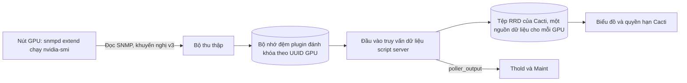

<!-- Source: README.md; SHA256: 97ba37df4a883426d3984ed7d14547ad7367e973411a8abd930409ce259f545b -->

<!-- translations:start -->
[English](../../../README.md) | [简体中文](../zh-CN/README.md) | [हिन्दी](../hi-IN/README.md) | [Español (España)](../es-ES/README.md) | [Español (Latinoamérica)](../es-419/README.md) | [العربية (السعودية)](../ar-SA/README.md) | [Afrikaans](../af-ZA/README.md) | [አማርኛ](../am-ET/README.md) | [العربية (مصر)](../ar-EG/README.md) | [العربية (المغرب)](../ar-MA/README.md) | [বাংলা](../bn-BD/README.md) | [Bosanski](../bs-BA/README.md) | [Deutsch](../de-DE/README.md) | [فارسی](../fa-IR/README.md) | [Filipino](../fil-PH/README.md) | [Français](../fr-FR/README.md) | [Français (Maroc)](../fr-MA/README.md) | [Français (Sénégal)](../fr-SN/README.md) | [Hausa](../ha-NG/README.md) | [עברית](../he-IL/README.md) | [Hrvatski](../hr-HR/README.md) | [Bahasa Indonesia](../id-ID/README.md) | [Igbo](../ig-NG/README.md) | [Italiano](../it-IT/README.md) | [日本語](../ja-JP/README.md) | [한국어](../ko-KR/README.md) | [Malagasy](../mg-MG/README.md) | [मराठी](../mr-IN/README.md) | [Bahasa Melayu](../ms-MY/README.md) | [Nederlands](../nl-NL/README.md) | [Polski](../pl-PL/README.md) | [Português (Brasil)](../pt-BR/README.md) | [Русский](../ru-RU/README.md) | [Kinyarwanda](../rw-RW/README.md) | [Soomaali](../so-SO/README.md) | [Српски](../sr-RS/README.md) | [Svenska](../sv-SE/README.md) | [Kiswahili](../sw-KE/README.md) | [தமிழ்](../ta-IN/README.md) | [తెలుగు](../te-IN/README.md) | [ไทย](../th-TH/README.md) | [Türkçe](../tr-TR/README.md) | [Українська](../uk-UA/README.md) | [اردو](../ur-PK/README.md) | [Tiếng Việt](README.md) | [isiXhosa](../xh-ZA/README.md) | [Yorùbá](../yo-NG/README.md) | [繁體中文](../zh-TW/README.md) | [isiZulu](../zu-ZA/README.md)
<!-- translations:end -->

# plugin_gpu

Một plugin của Cacti 1.2 giúp đưa các thông số theo từng GPU như mức sử dụng, bộ nhớ, nhiệt độ, công suất, lỗi ECC và nguyên nhân điều tiết (throttling) từ các công cụ NVIDIA vào Cacti. Hỗ trợ AMD và thu thập lỗi XID nằm trong kế hoạch, chưa được triển khai. Mỗi GPU trở thành một chỉ mục của một truy vấn dữ liệu (data query) trên thiết bị nút của nó, nhờ đó biểu đồ GPU nằm cạnh các biểu đồ khác của nút theo hệ thống phân quyền của Cacti, đồng thời Thold và Maint có thể cảnh báo và tạm ẩn cảnh báo trên chúng.

> **Trạng thái: đang phát triển, chưa phát hành.** Cột mốc 4 hoàn thiện mã nguồn cho giai đoạn 1 (NVIDIA qua SNMP extend): thu thập dữ liệu, định danh, biểu đồ, tín hiệu điều tiết và ECC, cảnh báo qua Thold và Maint, trang tình trạng (health page) và tài liệu vận hành. Mã mới chỉ được chạy thử với `snmpd` thật cùng một `nvidia-smi` giả lập in ra đầu ra tổng hợp, chưa từng chạy trên phần cứng GPU thật. Các hạng mục còn mở trước khi phát hành gồm: thử nghiệm thí điểm trên phần cứng thật ([docs/pilot-plan.md](../../pilot-plan.md), #54), đánh giá bảo mật bên ngoài ([docs/security-review.md](../../security-review.md)), bộ dữ liệu mẫu thu từ công cụ thật (#14), và đo lường khả năng mở rộng trên phần cứng cỡ môi trường sản xuất ([docs/performance.md](../../performance.md)). Lỗi XID đang chờ quyết định #8. Không sử dụng trong môi trường sản xuất.

## Vai trò truy cập

| Quyền hạn (Realm) | Quyền truy cập |
| --- | --- |
| GPU View | Các trang giám sát hiện có. |
| GPU Operator | Quyền giám sát cộng với trang Operations và các xác nhận phân loại cá nhân. |
| GPU Admin | Quyền của Operator cộng với các thao tác cấu hình và quản trị hiện có. |

Sau khi sao chép các tệp nâng cấp, hãy mở trang Plugins với tư cách quản trị viên để đăng ký quyền hạn (realm) mới. Gán quyền Operator một cách tường minh trong mục **Configuration > Users** hoặc các nhóm người dùng. Quá trình nâng cấp vẫn giữ nguyên các ID và quyền đã cấp của View và Admin hiện có. Quyền Admin kế thừa quyền Operator, và quyền Operator kế thừa quyền View trên mỗi yêu cầu; việc này không thêm quyền lưu trữ vào người dùng hay nhóm. Phần cài đặt của plugin cũng yêu cầu quyền GPU Admin bên cạnh quyền Settings của Cacti.

Quyền thiết bị trong Cacti vẫn giới hạn các hàng và thao tác khả dụng đối với mỗi người dùng; các đối tượng chưa ánh xạ yêu cầu quản trị viên. Thông tin xác thực, cấu hình, ánh xạ, xóa và các thay đổi quản trị khác vẫn nằm trong các trang quản trị. Các xác nhận chỉ tồn tại trong phiên làm việc hiện tại của người dùng, tối đa một giờ và chỉ khi cùng một quan sát vẫn còn mới. Các quan sát mới hoặc thay đổi sẽ làm mất hiệu lực của chúng. Chúng không bao giờ đánh dấu một phép đo thất bại là bình thường hay tạm ẩn cảnh báo.

## Lý do

Các nút GPU thường đã có sẵn trong Cacti để theo dõi CPU, bộ nhớ và giao diện mạng. Tình trạng GPU là một vấn đề riêng mà dữ liệu SNMP của nút không trả lời được: một card có thể bị điều tiết do nhiệt, tích lũy lỗi ECC hoặc báo lỗi XID trong khi bản thân nút vẫn có vẻ bình thường. Công cụ của nhà sản xuất có báo cáo thông tin này (`nvidia-smi`, DCGM, `amd-smi`), nhưng đầu ra của chúng nằm ngoài hệ thống biểu đồ, phân quyền và cảnh báo của Cacti.

Plugin thu hẹp khoảng cách đó bằng cách chuyển đầu ra từ công cụ của nhà sản xuất thành các nguồn dữ liệu của Cacti, được đánh khóa theo danh tính của từng GPU thay vì vị trí của nó, nhờ đó việc khởi động lại làm thay đổi thứ tự GPU sẽ không gắn lịch sử của card này sang card khác. Plugin tái sử dụng hệ thống biểu đồ, phân quyền, bộ thu thập dữ liệu từ xa, Thold và Maint của Cacti thay vì xây dựng các phiên bản song song.

## Phạm vi dự kiến

| Giai đoạn | Phạm vi | Cột mốc |
|---|---|---|
| 0, nghiên cứu | Đầu ra công cụ nhà sản xuất, tín hiệu XID và điều tiết, định danh GPU, đặc quyền, quyết định đường thu thập | [M1](https://github.com/somethingwithproof/plugin_gpu/milestone/1) |
| 1, nvidia | Thu thập qua `nvidia-smi`, kiểm kê theo UUID, biểu đồ, tín hiệu điều tiết, ECC và XID, Thold và Maint, trang tình trạng | [M2](https://github.com/somethingwithproof/plugin_gpu/milestone/2), [M3](https://github.com/somethingwithproof/plugin_gpu/milestone/3), [M4](https://github.com/somethingwithproof/plugin_gpu/milestone/4) |
| 2, các backend | Backend DCGM, backend `amd-smi` | [M5](https://github.com/somethingwithproof/plugin_gpu/milestone/5) |
| 3, mig và từ xa | Phiên bản MIG, các bộ thu thập dữ liệu từ xa của Cacti | [M6](https://github.com/somethingwithproof/plugin_gpu/milestone/6) |

Ngoài phạm vi: bất kỳ lệnh nào làm thay đổi GPU hoặc nút (xung nhịp, giới hạn công suất, đặt lại, bố cục MIG), một công cụ cảnh báo riêng của plugin, một daemon hoặc giao thức mạng tùy chỉnh, và hạch toán trình lập lịch hoặc tác vụ. Xem bản kế hoạch để biết các hạng mục nghiên cứu tồn đọng.

## Những gì cột mốc 4 bổ sung

- **Lý do điều tiết dưới dạng giá trị cảnh báo.** Mặt nạ sự kiện xung nhịp được giải mã thành một chỉ báo 0 hoặc 1 cho mỗi lý do; một mặt nạ không xác định sẽ cho ra các chỉ báo không xác định, không bao giờ cho ra số 0, và các bit không có chỉ báo sẽ được giữ lại trong mặt nạ thô được hiển thị trên **GPU Health**.
- **ECC dưới dạng giá trị cảnh báo** ([docs/metrics.md](../../metrics.md)). Số lỗi đã sửa và chưa sửa mới phát sinh kể từ mẫu trước đó được plugin tính từ hai tổng liên tiếp và lưu dưới dạng gauge: không xác định đối với mẫu đầu tiên, lần đọc bị lỡ hoặc khi nạp lại driver, để một lần đặt lại không bao giờ bị đọc thành 0 hoặc số âm. Số lượng trang single-bit và double-bit đã nghỉ hưu cùng chế độ ECC cũng được đọc. Hai biểu đồ ECC bổ sung cho mỗi GPU cho phép Cacti lưu trữ chúng; cùng với Power Percent, tổng cộng có mười một biểu đồ. XID chưa được thu thập: không có nguồn nào phù hợp với các lệnh `nvidia-smi` cố định (#8).
- **Thold và Maint** ([docs/alerting.md](../../alerting.md)). Các mẫu Thold đi kèm sẵn cho nhiệt độ, công suất so với giới hạn, các chỉ báo điều tiết, lỗi ECC chưa sửa mới, trang chờ nghỉ hưu và tuổi mẫu. Mọi giá trị đều là gauge, vì Thold 1.8.2 gặp lỗi với counter không xác định. Một kiểm thử đầu-cuối với Thold 1.8.2 và Maint 1.3 nguyên bản cho thấy từng ngưỡng kích hoạt và khôi phục xuyên qua một lần đặt lại ECC, và được Maint tạm ẩn.
- **GPU Health** (GPU View). Theo từng nút: độ tươi của dữ liệu, cách lần thu thập gần nhất kết thúc, trạng thái Maint, backend, phiên bản công cụ và driver, và số lượng GPU; theo từng GPU: sự hiện diện, tuổi mẫu, trạng thái ECC và mặt nạ thô. Trang này chỉ đọc các bản ghi đã lưu trữ.
- **Phân quyền.** Bộ kiểm thử phân quyền bao phủ mọi tệp trang và thao tác, việc thu hồi quyền ngay ở yêu cầu tiếp theo, và các phản hồi từ chối không để lộ thông tin gì.
- **Kiểm định lỗi và khôi phục.** Các lượt chạy đầu-cuối theo kịch bản làm hỏng agent, thông tin xác thực, công cụ, đầu ra của nó, kết nối cơ sở dữ liệu và thao tác ghi RRD, đồng thời khôi phục cơ sở dữ liệu từ bản sao lưu, bao gồm cả bản sao lưu cũ hơn các tệp RRD; một GPU mới không bao giờ kế thừa tệp RRD của GPU khác ([docs/backup.md](../../backup.md)).
- **Khả năng mở rộng** ([docs/performance.md](../../performance.md)). Một kiểm thử khả năng mở rộng đo thời gian thu thập, đầu vào script server, tạo đối tượng Cacti, một chu kỳ poller và trang tình trạng ở một số lượng GPU nhất định; CI chạy kiểm thử này ở mức 100 GPU. Các phép đo ở mức 1.000 và 8.000 GPU chưa được ghi nhận, nên chưa công bố số lượng GPU được hỗ trợ.
- **Tài liệu vận hành** ([docs/operations.md](../../operations.md)): cài đặt, nâng cấp, gỡ cài đặt, đặc quyền tối thiểu, giá trị không khả dụng và xử lý sự cố. Các thay đổi được liệt kê trong [CHANGELOG.md](../../../CHANGELOG.md).

## Những gì cột mốc 3 bổ sung

- **Thu thập qua SNMP extend** ([ADR 0008](../../decisions/0008-collect-through-snmp-extend.md)). Quản trị viên của nút thêm hai dòng `extend` cố định vào `snmpd.conf` ([docs/node-setup.md](../../node-setup.md)); plugin đọc NET-SNMP-EXTEND-MIB thông qua các hàm SNMP của Cacti bằng thông tin xác thực riêng của thiết bị, khuyến nghị dùng SNMPv3. Nó không chạy bất kỳ thứ gì trên máy chủ Cacti hoặc trên nút.
- **Phân tích cú pháp nghiêm ngặt.** Các trường được đọc theo vị trí, mỗi dòng định danh GPU của nó bằng UUID, và bất kỳ trạng thái thoát khác 0, hết thời gian chờ, đầu ra bị cắt ngắn, dòng có sai số lượng trường, hoặc văn bản lỗi bị trộn lẫn đều làm hỏng toàn bộ lần thu thập: các giá trị trở thành `U`, không GPU nào bị đánh dấu vắng mặt, và **GPU Nodes** hiển thị lý do.
- **Bộ thu thập chạy sau mỗi chu kỳ poller.** Nó đọc agent của từng nút đã bật, cập nhật các bản ghi định danh và lưu đệm mẫu mới nhất. Đầu vào script server chỉ đọc bộ nhớ đệm đó, nên một lượt poll của Cacti không bao giờ phải chờ nút GPU.
- **Đối tượng Cacti** ([ADR 0010](../../decisions/0010-attach-to-existing-node-devices.md)). Các mẫu và truy vấn dữ liệu *GPU - Devices* được đóng gói dưới dạng XML và được nhập khi cài đặt và nâng cấp. Khi lưu một nút, truy vấn dữ liệu sẽ được gắn vào thiết bị hiện có của nó với phương thức lập lại chỉ mục là None; **GPU Nodes** chỉ có thể tạo thiết bị khi nút chưa có thiết bị nào. Mỗi GPU là một chỉ mục được đánh khóa theo nhà sản xuất và UUID, với một nguồn dữ liệu được dùng chung bởi các biểu đồ Utilization, Memory, Temperature, Power, Power Percent, Clocks, Throttle, ECC Errors, New ECC Errors, Retired Pages và Sample Age. Mọi trường mô hình đều được vẽ bởi một biểu đồ nào đó, vì Cacti chỉ lưu trữ các trường mà biểu đồ sử dụng. Plugin lập lại chỉ mục sau mỗi lần thay đổi GPU, giữ lại lượt lập lại chỉ mục mà Cacti đã bỏ qua khi thiết bị ở trạng thái Down hoặc bị vô hiệu hóa để chạy ngay khi thiết bị Up trở lại, và tạo biểu đồ cho các GPU mới.
- **Lịch sử luôn gắn liền với card.** Một GPU vắng mặt vẫn giữ nguyên là một chỉ mục, nên biểu đồ của nó sẽ hiển thị một khoảng trống và tiếp tục ghi vào cùng tệp RRD khi nó quay trở lại. Một card thay thế ở cùng khe cắm sẽ nhận được nguồn dữ liệu riêng. Thao tác **Remove from Data Query** trên trang của nút sẽ đưa GPU vắng mặt ra khỏi danh sách; các tệp RRD và biểu đồ của nó vẫn được giữ lại cho đến khi bạn xóa chúng.
- **Quyền thiết bị trên GPU Nodes.** Một GPU Admin chỉ xem, thay đổi, xuất và di chuyển các nút và GPU trên những thiết bị mà họ được phép xem trong Cacti; thao tác di chuyển GPU cần quyền trên cả hai nút. Một nút có thiết bị đã bị xóa có thể bị vô hiệu hóa hoặc xóa.
- **Mô hình chỉ số chung** ([ADR 0009](../../decisions/0009-common-metric-core-with-vendor-extensions.md), [docs/metrics.md](../../metrics.md)). Bộ nhớ tính bằng byte, mặt nạ sự kiện xung nhịp được giải mã thành các chỉ báo `thr_*`, và `age` là tuổi của thời điểm lấy mẫu riêng của GPU, hoặc `U` khi không xác định.

Người dùng thực hiện cài đặt (máy chủ web) phải có quyền ghi vào `<cacti>/resource/script_server/`, nơi plugin đặt tệp XML truy vấn dữ liệu của mình; nếu không, quá trình cài đặt và nâng cấp sẽ dừng lại với thông báo lỗi và thử lại ở lần tiếp theo. Quá trình gỡ cài đặt chỉ xóa các mẫu và tệp XML khi *Remove the plugin's Cacti objects on uninstall* được chọn, và không bao giờ xóa tệp RRD, thiết bị, biểu đồ hoặc nguồn dữ liệu ([docs/operations.md](../../operations.md#uninstall)). Các nút trên bộ thu thập dữ liệu từ xa sẽ chưa được thu thập cho đến giai đoạn 3.

## Những gì cột mốc 2 cung cấp

- **Cài đặt có kiểm soát.** Trên PHP dưới 8.2, việc cài đặt và kích hoạt bị từ chối với thông báo nêu rõ phiên bản yêu cầu, và phần còn lại của Cacti vẫn hoạt động bình thường. `setup.php` và các script trang vẫn phân tích cú pháp hợp lệ trên PHP 8.0.
- **Vòng đời.** Cài đặt, nâng cấp, vô hiệu hóa và gỡ cài đặt thông qua trang Plugins của Cacti. Các bước nâng cấp có thứ tự, hoàn tất sau khi bị gián đoạn và chỉ thay đổi phiên bản đã ghi nhận sau khi thành công. Việc gỡ cài đặt giữ lại các bảng của plugin trừ khi bạn bỏ chọn *Keep Plugin Tables on Uninstall*; nó không bao giờ chạm vào thiết bị, nguồn dữ liệu, biểu đồ hoặc tệp RRD nào của Cacti.
- **Quyền hạn tách biệt.** *GPU Admin* mở **GPU Nodes**, nơi bạn đăng ký các thiết bị Cacti làm nút GPU, xác nhận hoặc từ chối việc di chuyển GPU giữa các nút, và xuất mọi bản ghi dưới dạng JSON. *GPU View* mở **GPU Inventory**, liệt kê GPU chỉ trên những thiết bị mà người xem được phép xem. Cả hai trang đều nằm dưới mục Management, và mọi thay đổi đều là yêu cầu POST được kiểm tra bởi csrf-magic.
- **Bản ghi định danh GPU.** Mỗi GPU được đánh khóa theo nhà sản xuất và UUID. Chỉ mục, ID bus PCI, tên, driver và công cụ báo cáo là các thuộc tính thay đổi tại chỗ. Một UUID mới xuất hiện ở khe cắm đã biết sẽ được gắn cờ là khả năng thay thế và bắt đầu lịch sử riêng; một GPU được nhìn thấy ở nút khác chỉ chuyển sang khi người vận hành xác nhận; một GPU biến mất khỏi các lần thu thập thành công sẽ bị đánh dấu vắng mặt sau một số lần có thể cấu hình và không bao giờ bị xóa. Hiện chỉ chấp nhận UUID toàn bộ GPU của NVIDIA; các phiên bản MIG đang chờ quyết định #13, và AMD chờ nghiên cứu #19. Các quy tắc được kiểm chứng bằng chuỗi dữ liệu mẫu, vì chưa có bộ thu thập nào cấp dữ liệu cho chúng.
- **Kiểm thử và CI.** Các bộ kiểm thử đơn vị và quy tắc mã nguồn không cần GPU hay cơ sở dữ liệu, kiểm tra vòng đời và phân quyền trang trên Cacti 1.2.31 và nhánh 1.2.x hiện tại với PHP 8.2 đến 8.5, một tác vụ từ chối trên PHP 8.1, kiểm tra cú pháp PHP 8.0 đối với các điểm vào, PHPStan ở mức 9 và REUSE. Bộ khung kiểm thử này mang tính tạm thời cho đến khi #12 được quyết định.

### Cài đặt để đánh giá

Các bước này cài đặt mã nguồn hiện tại để dùng thử; [docs/operations.md](../../operations.md) có hướng dẫn vận hành đầy đủ. Yêu cầu Cacti 1.2.31 trở lên trên PHP 8.2 trở lên.

1. Sao chép kho mã nguồn vào `plugins/gpu` dưới thư mục Cacti của bạn. Thư mục phải được đặt tên là `gpu`.
2. Trong Cacti, mở **Configuration > Plugins**, sau đó cài đặt và kích hoạt **GPU**.
3. Cấp cho người dùng quyền hạn *GPU View*, *GPU Operator* hoặc *GPU Admin* trong mục **Configuration > Users**, tùy theo vai trò của họ. Người dùng thực hiện cài đặt nhận được quyền View và Admin; Admin đã bao gồm quyền Operator.
4. Thiết lập SNMP agent của từng nút GPU như mô tả trong [docs/node-setup.md](../../node-setup.md), sau đó thêm nút trong mục **Management > GPU Nodes**.
5. Để nhận cảnh báo, hãy nhập các mẫu Thold đi kèm theo hướng dẫn tại [docs/alerting.md](../../alerting.md).
6. Tùy chọn điều chỉnh **Configuration > Settings > GPU**: *Mark Absent After* (mặc định 3 lần thu thập thành công, từ 1 đến 100), *Stale After* (tuổi tối đa của một mẫu trước khi các giá trị của nó in ra `U`) và *Keep Plugin Tables on Uninstall* (mặc định bật).

## Cách chỉ số đi tới Cacti

Quyết định [#7](https://github.com/somethingwithproof/plugin_gpu/issues/7) đã chọn SNMP `extend` ([ADR 0008](../../decisions/0008-collect-through-snmp-extend.md)): agent của chính nút đó chạy một lệnh `nvidia-smi` cố định và plugin chỉ đọc kết quả. Bản kế hoạch so sánh các phương án trong mục [Các đường thu thập](../../PLAN.md#collection-paths).

## Mục tiêu tương thích

| Thành phần | Mục tiêu |
|---|---|
| Cacti | 1.2.31 trở lên, không cần vá mã lõi |
| PHP | 8.2 trở lên; `setup.php` vẫn phân tích cú pháp được trên 8.0 để môi trường không được hỗ trợ nhận được thông báo từ chối thay vì làm hỏng giao diện Cacti |
| NVIDIA | Các dòng driver và công cụ sẽ được xác định bởi nghiên cứu [#26](https://github.com/somethingwithproof/plugin_gpu/issues/26); các ID trường DCGM đã được kiểm tra ở v3.3.9 và v4.7.0 |
| AMD | `amd-smi` trên các bản phát hành ROCm sẽ được xác định bởi nghiên cứu [#26](https://github.com/somethingwithproof/plugin_gpu/issues/26) |
| Thold, Maint | Thold 1.8.2 và Maint 1.3, nguyên bản, đã kiểm thử đầu-cuối ([docs/alerting.md](../../alerting.md)) |

## Thiết kế

- [docs/PLAN.md](../../PLAN.md) là bản kế hoạch đầy đủ: kiến trúc, các dữ kiện thượng nguồn mà nó phụ thuộc vào (kèm nguồn), mô hình định danh, ranh giới bảo mật, tính toán hiệu năng, kiểm thử và rủi ro.
- [docs/decisions/](../../decisions) lưu giữ các bản ghi quyết định kiến trúc cho những lựa chọn đã được đưa ra.
- [docs/REQUIREMENTS.md](../../REQUIREMENTS.md) ánh xạ từng ID yêu cầu tới issue tương ứng của nó.

## Cách theo dõi công việc

- **Cột mốc** bám theo các cột mốc của bản kế hoạch. Mỗi cột mốc có một epic issue liệt kê các issue con và bằng chứng hoàn thành.
- **Issue** được phân loại theo nhãn: `type: requirement`, `type: research`, `type: decision`, `type: epic`. Các issue yêu cầu nêu rõ các yêu cầu được đánh số và có thể kiểm thử (`REQ-AREA-NNN`) cùng tiêu chí nghiệm thu.
- **Nhãn** cũng mang các tiền tố `area:`, `phase:`, `priority:` và `status:`. Xem [CONTRIBUTING.md](../../../CONTRIBUTING.md#labels).
- [Bảng dự án](https://github.com/users/somethingwithproof/projects/9) hiển thị toàn bộ các issue xuyên suốt các cột mốc.

## Đóng góp

Đọc [CONTRIBUTING.md](../../../CONTRIBUTING.md). Các commit cần có chữ ký xác nhận DCO. Thảo luận thiết kế diễn ra trên các issue; các quyết định đang mở mang nhãn `type: decision`. Đầu ra thu thập được từ các công cụ GPU thật là đóng góp hữu ích nhất cho cột mốc 1; hãy xóa tên máy chủ, số sê-ri và UUID trước khi gửi.

## Bảo mật

Báo cáo lỗ hổng bảo mật một cách riêng tư; xem [SECURITY.md](../../../SECURITY.md).

## Giấy phép

GNU General Public License v2.0, cùng giấy phép với Cacti và các plugin của nó. Xem [LICENSE](../../../LICENSE).
