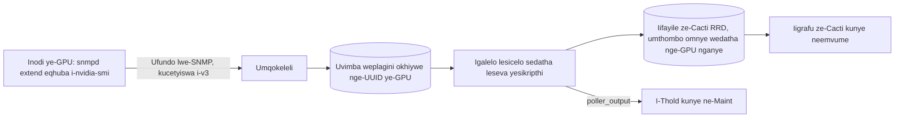

<!-- Source: README.md; SHA256: 126deef1783d64f878bf565f1433c10f31aef828eb9bc313aeff2b0335e54c7c -->

<!-- translations:start -->
[English](../../../README.md) | [简体中文](../zh-CN/README.md) | [हिन्दी](../hi-IN/README.md) | [Español (España)](../es-ES/README.md) | [Español (Latinoamérica)](../es-419/README.md) | [العربية (السعودية)](../ar-SA/README.md) | [Afrikaans](../af-ZA/README.md) | [አማርኛ](../am-ET/README.md) | [العربية (مصر)](../ar-EG/README.md) | [العربية (المغرب)](../ar-MA/README.md) | [বাংলা](../bn-BD/README.md) | [Deutsch](../de-DE/README.md) | [فارسی](../fa-IR/README.md) | [Filipino](../fil-PH/README.md) | [Français](../fr-FR/README.md) | [Français (Maroc)](../fr-MA/README.md) | [Français (Sénégal)](../fr-SN/README.md) | [Hausa](../ha-NG/README.md) | [עברית](../he-IL/README.md) | [Bahasa Indonesia](../id-ID/README.md) | [Igbo](../ig-NG/README.md) | [Italiano](../it-IT/README.md) | [日本語](../ja-JP/README.md) | [한국어](../ko-KR/README.md) | [Malagasy](../mg-MG/README.md) | [मराठी](../mr-IN/README.md) | [Bahasa Melayu](../ms-MY/README.md) | [Nederlands](../nl-NL/README.md) | [Polski](../pl-PL/README.md) | [Português (Brasil)](../pt-BR/README.md) | [Русский](../ru-RU/README.md) | [Kinyarwanda](../rw-RW/README.md) | [Soomaali](../so-SO/README.md) | [Svenska](../sv-SE/README.md) | [Kiswahili](../sw-KE/README.md) | [தமிழ்](../ta-IN/README.md) | [తెలుగు](../te-IN/README.md) | [ไทย](../th-TH/README.md) | [Türkçe](../tr-TR/README.md) | [Українська](../uk-UA/README.md) | [اردو](../ur-PK/README.md) | [Tiếng Việt](../vi-VN/README.md) | [isiXhosa](README.md) | [Yorùbá](../yo-NG/README.md) | [繁體中文](../zh-TW/README.md) | [isiZulu](../zu-ZA/README.md)
<!-- translations:end -->

# plugin_gpu

Iplagini ye-Cacti 1.2 ezisa ukusetyenziswa kwe-GPU nganye, imemori, ubushushu, amandla ombane, iimpazamo ze-ECC, kunye nezizathu zokunciphisa isantya ezivela kwizixhobo ze-NVIDIA kwi-Cacti. Inkxaso ye-AMD kunye nokuqokelelwa kweempazamo ze-XID zicwangcisiwe, azikamiselwa. I-GPU nganye iba sisalathiso sesicelo sedatha kwisixhobo senodi yayo, ukuze iigrafu ze-GPU zihlale ecaleni kwezinye iigrafu zenodi phantsi kweemvume ze-Cacti, kwaye i-Thold ne-Maint zikwazi ukuthumela izilumkiso kwaye zizibambe.

> **Ubume: isaphuhliswa, ayikakhululwa.** Inqanaba lesi-4 lenza isigaba soku-1 (i-NVIDIA nge-SNMP extend) sigqibelele ngokwekhowudi: ukuqokelela, ubuwena be-GPU, iigrafu, imiqondiso yokunciphisa isantya neye-ECC, izilumkiso ze-Thold neze-Maint, iphepha lempilo, kunye namaxwebhu omsebenzisi-nkqubo. Iqhutywe kuphela ngokuchasene ne-`snmpd` yokwenyani ene-`nvidia-smi` eyenziweyo eprinta isiphumo esenziweyo, ayizange iqhutywe kwizixhobo ze-GPU zokwenyani. Okusavulekile ngaphambi kokukhululwa: iinkqubo zovavanyo kwizixhobo zokwenyani ([docs/pilot-plan.md](../../pilot-plan.md), #54), uphononongo lwangaphandle lokhuseleko ([docs/security-review.md](../../security-review.md)), iisampulu ezithathwe kwizixhobo zokwenyani (#14), kunye nomlinganiselo wobungakanani kwizixhobo ezilingana nezemveliso ([docs/performance.md](../../performance.md)). Iimpazamo ze-XID zilinde isigqibo #8. Musa ukuyisebenzisa kwimveliso.

## Iindima zofikelelo

| Ummandla | Ufikelelo |
| --- | --- |
| GPU View | Amaphepha okubeka iliso akhoyo. |
| GPU Operator | Ukubeka iliso kunye nephepha le-Operations nezivumo zobuqu zokuhlela imiba. |
| GPU Admin | Ufikelelo lwe-Operator kunye noqwalaselo olukhoyo nezenzo zolawulo. |

Emva kokukopa iifayile zohlaziyo, vula iphepha le-Plugins njengomlawuli ukuze ubhalise ummandla omtsha. Yabela ummandla we-Operator ngokucacileyo phantsi kwe-**Configuration > Users** okanye amaqela abasebenzisi. Uhlaziyo lugcina ii-ID kunye nezibonelelo zommandla we-View newe-Admin ezikhoyo. Ufikelelo lwe-Admin lufumana ilifa lofikelelo lwe-Operator, kwaye ufikelelo lwe-Operator lufumana ilifa lofikelelo lwe-View kwisicelo ngasinye; oku akongezi zibonelelo zigciniweyo kubasebenzisi okanye kumaqela. Iisethingi zeplagini nazo zifuna ufikelelo lwe-GPU Admin ukongeza kwimvume ye-Settings ye-Cacti.

Iimvume zezixhobo ze-Cacti zisayilinganisela imiqolo kunye nezenzo ezifumaneka kumsebenzisi ngamnye; izinto ezingametywanga zifuna umlawuli. Iziqinisekiso, uqwalaselo, umepho, ukucima kunye nolunye utshintsho lolawulo zihlala kumaphepha olawulo. Izivumo zihlala kuphela kwiseshoni yomsebenzisi wangoku, kangangeyure enye ubuninzi kwaye kuphela ngelixa kwa oko kuqwalaselweyo kusekutsha. Uqwalaselo olutsha okanye olutshintshileyo luyaziphelisa. Azize ziphawule umlinganiselo ohlulekileyo njengosempilweni okanye zibambe izilumkiso.

## Kutheni

Iinodi ze-GPU ziqhele ukuba sele zikwi-Cacti nge-CPU, imemori, kunye nojongano lwenethiwekhi. Impilo ye-GPU ngumbuzo owahlukileyo idatha ye-SNMP yenodi engawuphenduliyo: ikhadi linokuncitshiswa isantya ngenxa yobushushu, liqokelele iimpazamo ze-ECC, okanye linike ingxelo yempazamo ye-XID ngelixa inodi ngokwayo ibonakala isempilweni. Izixhobo zabathengisi ziyayixela (`nvidia-smi`, i-DCGM, `amd-smi`), kodwa isiphumo sazo sihlala ngaphandle kweegrafu, iimvume, kunye nezilumkiso ze-Cacti.

Iplagini iyavala eso sikhewu ngokuguqula isiphumo sesixhobo somthengisi sibe yimithombo yedatha ye-Cacti, ekhiywe ngobuwena be-GPU nganye endaweni yendawo yayo, ukuze ukuqalisa kwakhona okucwangcisa ngokutsha ii-GPU kungafakeli imbali yekhadi elinye kwelinye. Isebenzisa kwakhona ukuzoba iigrafu kwe-Cacti, iimvume, abaqokeleli bedatha abakude, i-Thold, kunye ne-Maint endaweni yokwakha iinguqulelo zazo ezihambelanayo.

## Umda ocwangcisiweyo

| Isigaba | Umda | Amanqanaba |
|---|---|---|
| 0, uphando | Isiphumo sesixhobo somthengisi, imiqondiso ye-XID neyokunciphisa isantya, ubuwena be-GPU, amalungelo, isigqibo sendlela yokuqokelela | [M1](https://github.com/somethingwithproof/plugin_gpu/milestone/1) |
| 1, nvidia | Ukuqokelela kwe-`nvidia-smi`, uluhlu nge-UUID, iigrafu, imiqondiso yokunciphisa isantya, i-ECC ne-XID, i-Thold ne-Maint, iphepha lempilo | [M2](https://github.com/somethingwithproof/plugin_gpu/milestone/2), [M3](https://github.com/somethingwithproof/plugin_gpu/milestone/3), [M4](https://github.com/somethingwithproof/plugin_gpu/milestone/4) |
| 2, ii-backend | I-backend ye-DCGM, i-backend ye-`amd-smi` | [M5](https://github.com/somethingwithproof/plugin_gpu/milestone/5) |
| 3, i-mig nokukude | Imizekelo ye-MIG, abaqokeleli bedatha abakude be-Cacti | [M6](https://github.com/somethingwithproof/plugin_gpu/milestone/6) |

Okungaphandle komda: nawuphi na umyalelo otshintsha i-GPU okanye inodi (iiwotshi, imida yamandla ombane, ukusetha ngokutsha, uyilo lwe-MIG), injini yezilumkiso elawulwa yiplagini, i-daemon yesiqhelo okanye iprothokholi yenethiwekhi, kunye nolawulo lweengxelo lomsebenzi okanye lweshedyuli. Jonga isicwangciso ngomsebenzi wophando osele ulindile.

## Okongezwa linqanaba lesi-4

- **Izizathu zokunciphisa isantya njengamaxabiso ezilumkiso.** Imaski yesiganeko sewotshi icazululwa ibe sisalathiso esinye sika-0 okanye sika-1 ngesizathu ngasinye; imaski engaziwayo inika izalathiso ezingaziwayo, ayize inike oozero, kwaye iibhithi ezingenasalathiso zihlala kwimaski ekrwada, eboniswa yi-GPU Health.
- **I-ECC njengamaxabiso ezilumkiso** ([docs/metrics.md](../../metrics.md)). Iimpazamo ezintsha ezilungisiweyo nezingalungiswanga ukususela kwisampulu edlulileyo zibalwa yiplagini ukusuka kwiindibano ezimbini ezilandelelanayo kwaye zigcinwa njengee-gauge: azaziwa kwisampulu yokuqala, ukufunda okulahlekileyo, okanye ukulayishwa kwakhona komqhubi, ukuze ukusetha ngokutsha kungaze kufundwe njengozero okanye njengenani elingaphantsi kwezero. Amanani amaphepha abhithi enye nawamabhithi amabini athatyathwe umhlala-phantsi kunye nemowudi ye-ECC nazo ziyafundwa. Iigrafu ezimbini ezongezelelweyo ze-ECC nge-GPU nganye zivumela i-Cacti ukuba izigcine; kunye ne-Power Percent, zili-11 iigrafu zizonke. I-XID ayiqokelelwa: akukho mthombo uhambelana nemiyalelo emiselweyo ye-`nvidia-smi` (#8).
- **I-Thold kunye ne-Maint** ([docs/alerting.md](../../alerting.md)). Iitemplate ze-Thold ezithunyelwayo zobushushu, amandla ombane ngokuchasene nomda wawo, izalathiso zokunciphisa isantya, iimpazamo ezintsha ze-ECC ezingalungiswanga, umhlala-phantsi wephepha olindileyo, kunye nobudala besampulu. Ixabiso ngalinye liyi-gauge, kuba i-Thold 1.8.2 iyasilela kwikhawunta engaziwayo. Uvavanyo olusuka ekuqaleni ukuya esiphelweni nge-Thold 1.8.2 ne-Maint 1.3 ezingatshintshwanga lubonisa umda ngamnye uvutha kwaye ubuyela kwimeko yesiqhelo, kulo lonke ukusetha ngokutsha kwe-ECC, kwaye i-Maint iyawubamba.
- **I-GPU Health** (GPU View). Ngenodi nganye: ubutsha, indlela ukuqokelela kokugqibela okuphele ngayo, ubume be-Maint, i-backend, iinguqulelo zesixhobo nezomqhubi, kunye namanani ee-GPU; nge-GPU nganye: ubukho, ubudala besampulu, ubume be-ECC, kunye nemaski ekrwada. Ifunda iirekhodi ezigciniweyo kuphela.
- **Iimvume.** Isuyithi yeemvume igubungela yonke ifayile yephepha kunye nesenzo, ukubuyisela umva kwisicelo esilandelayo, kunye nokwaliwa okungaxeli nto.
- **Ukufaneleka kokusilela nokubuyisela.** Imisebenzi ebhalwe ngesikripthi esuka ekuqaleni ukuya esiphelweni yaphula iarhente, iziqinisekiso, isixhobo, isiphumo saso, uqhagamshelwano lwedathabheyisi, kunye nokubhala kwe-RRD, kwaye ibuyisela idathabheyisi kwisikhupho sayo, kuquka nesinye esidala kuneefayile ze-RRD; i-GPU entsha ayize ifumane ifayile ye-RRD yenye ([docs/backup.md](../../backup.md)).
- **Ubungakanani** ([docs/performance.md](../../performance.md)). Uvavanyo lobungakanani lubala ixesha lokuqokelela, igalelo leseva yesikripthi, ukudalwa kwezinto ze-Cacti, umjikelo we-poller, kunye nephepha lempilo kwinani elinikiweyo lee-GPU; i-CI iluqhuba kwii-GPU ezili-100. Imilinganiselo yee-GPU ezili-1,000 nezili-8,000 ayikabhalwa okwangoku, ngoko akukho nani le-GPU lixhaswayo elichaziweyo.
- **Amaxwebhu omsebenzisi-nkqubo** ([docs/operations.md](../../operations.md)): ukufakela, ukuhlaziya, ukususa, amalungelo amancinci, amaxabiso angafumanekiyo, kunye nokusombulula iingxaki. Utshintsho ludweliswe kwi-[CHANGELOG.md](../../../CHANGELOG.md).

## Okongezwa linqanaba lesi-3

- **Ukuqokelela nge-SNMP extend** ([ADR 0008](../../decisions/0008-collect-through-snmp-extend.md)). Umlawuli wenodi wongeza imigca emibini emiselweyo ye-`extend` kwi-`snmpd.conf` ([docs/node-setup.md](../../node-setup.md)); iplagini ifunda i-NET-SNMP-EXTEND-MIB ngemisebenzi ye-SNMP ye-Cacti ngeziqinisekiso zesixhobo ngokwaso, kucetyiswa i-SNMPv3. Ayiqhubi nto kwiseva ye-Cacti okanye kwinodi.
- **Ucazululo olungqongqo.** Imihlathi ifundwa ngokwendawo yayo, umgca ngamnye ubiza i-GPU yawo nge-UUID, kwaye ubume bokuphuma obungenguye uzero, ukuphela kwexesha, isiphumo esinqunyiweyo, umgca onenani elingalunganga lemihlathi, okanye umbhalo wempazamo odityanisiweyo uyawisa wonke umsebenzi wokuqokelela: amaxabiso aba ngu-`U`, akukho GPU iphawulwa njengengekho, kwaye i-GPU Nodes ibonisa isizathu.
- **Umqokeleli emva komjikelo ngamnye we-poller.** Ufunda iarhente yenodi nganye evuliweyo, uhlaziya iirekhodi zobuwena, kwaye ugcina isampulu yamva nje kuvimba wethutyana. Igalelo leseva yesikripthi lifunda loo vimba wethutyana kuphela, ukuze uvavanyo lwe-Cacti lungaze lulinde inodi ye-GPU.
- **Izinto ze-Cacti** ([ADR 0010](../../decisions/0010-attach-to-existing-node-devices.md)). Iitemplate kunye nesicelo sedatha se-*GPU - Devices* zithunyelwa njenge-XML kwaye zingeniswa ekufakelweni nasekuhlaziyweni. Ukugcina inodi kuncamathisela isicelo sedatha kwisixhobo sayo esikhoyo ngendlela yokuphinda wenze isalathiso engu-None; i-GPU Nodes ingadala isixhobo kuphela xa inodi ingenayo. I-GPU nganye sisalathiso esikhiywe ngumthengisi kunye ne-UUID, inomthombo omnye wedatha owabelwanayo yi-Utilization, Memory, Temperature, Power, Power Percent, Clocks, Throttle, ECC Errors, New ECC Errors, Retired Pages, kunye ne-Sample Age graphs. Umhlathi ngamnye wemodeli uzotywa yigrafu ethile, kuba i-Cacti igcina kuphela imihlathi esetyenziswa yigrafu. Iplagini iphinda yenze isalathiso emva kwalo lonke utshintsho lwe-GPU, igcina ukuphinda kwenziwa kwesalathiso i-Cacti ekutsibayo ngelixa isixhobo besiphantsi okanye sicinyiwe kwaye ikuqhube wakuba isixhobo siphakamile, kwaye idala iigrafu zee-GPU ezintsha.
- **Imbali ihlala nekhadi.** I-GPU engekho ihlala isisakhono sesalathiso, ukuze iigrafu zayo zibonise isikhewu kwaye ziqhube kwakhona kwakwifayile ye-RRD enye xa ibuya. Ikhadi elitshintshayo kwisikhundla esifanayo lifumana owalo umthombo wedatha. I-**Remove from Data Query** kwiphepha lenodi ikhupha i-GPU engekho kuluhlu; iifayile zayo ze-RRD kunye neegrafu ziyagcinwa de uzicime.
- **Iimvume zezixhobo kwi-GPU Nodes.** I-GPU Admin ibona, itshintsha, ithumela ngaphandle, kwaye ihambisa kuphela iinodi kunye nee-GPU ezikwizixhobo enokuzibona kwi-Cacti; ukuhambisa i-GPU kufuna zombini iinodi. Inodi esixhobo sayo sacinywayo ingavalwa okanye icinywe.
- **Imodeli eqhelekileyo yemilinganiselo** ([ADR 0009](../../decisions/0009-common-metric-core-with-vendor-extensions.md), [docs/metrics.md](../../metrics.md)). Imemori ikwii-byte, imaski yesiganeko sewotshi icazululwa ibe zizalathiso ze-`thr_*`, kwaye i-`age` bubudala bexesha lesampulu le-GPU ngokwayo, okanye u-`U` xa bungaziwa.

Umsebenzisi ofakelayo (oweseva yewebhu) kufuneka akwazi ukubhala kwi-`<cacti>/resource/script_server/`, apho iplagini ibeka khona i-XML yesicelo sedatha; ukufakela kunye nokuhlaziya kuyema ngomyalezo ukuba akunjalo kwaye kuphinde kuzame kulingo olulandelayo. Ukususa kuthatha iitemplate kunye ne-XML kuphela xa i-*Remove the plugin's Cacti objects on uninstall* ikhethiwe, kwaye akaze kucime iifayile ze-RRD, izixhobo, iigrafu, okanye imithombo yedatha ([docs/operations.md](../../operations.md#uninstall)). Iinodi ezikubaqokeleli bedatha abakude aziqokelelwa de kube sisigaba sesi-3.

## Okuhanjiswa linqanaba lesi-2

- **Ukufakela okukhuselekileyo.** Kwi-PHP engaphantsi kwe-8.2, ukufakela nokuvula kuyaliwa ngomyalezo obiza inguqulelo efunekayo, kwaye yonke enye i-Cacti iyaqhubeka isebenza. I-`setup.php` kunye nezikripthi zamaphepha ziyacazululeka kwi-PHP 8.0.
- **Umjikelo wobomi.** Ukufakela, ukuhlaziya, ukuvala, kunye nokususa ngephepha le-Plugins le-Cacti. Uhlaziyo lulandelelaniswa, lugqiba emva kokuphazamiseka, kwaye lutshintsha inguqulelo ebhalisiweyo kuphela emva kokuphumelela. Ukususa kugcina iitheyibhile zeplagini ngaphandle kokuba ucime i-*Keep Plugin Tables on Uninstall*; akaze kuchukumise isixhobo se-Cacti, umthombo wedatha, igrafu, okanye ifayile ye-RRD.
- **Imimandla eyahlukeneyo.** I-*GPU Admin* ivula i-**GPU Nodes**, apho ubhalisa khona izixhobo ze-Cacti njengeenodi ze-GPU, uqinisekise okanye wale ukuhamba kwee-GPU phakathi kweenodi, kwaye uthumele ngaphandle yonke irekhodi njenge-JSON. I-*GPU View* ivula i-**GPU Inventory**, edwelisa ii-GPU kuphela kwizixhobo umboni anokuzibona. Omabini amaphepha aphantsi kwe-Management, kwaye lonke utshintsho yi-POST ekhangelwa yi-csrf-magic.
- **Iirekhodi zobuwena be-GPU.** I-GPU nganye ikhiywe ngumthengisi kunye ne-UUID. Isalathiso, i-PCI bus ID, igama, umqhubi, kunye nesixhobo esinika ingxelo ziimpawu ezitshintsha kwindawo yazo. I-UUID entsha kwisikhundla esaziwayo iphawulwa njengokutshintsha okunokwenzeka kwaye iqala eyayo imbali; i-GPU ebonwe kwenye inodi ihamba kuphela xa umsebenzisi-nkqubo eqinisekisa; i-GPU elahlekileyo kwimisebenzi yokuqokelela ephumeleleyo iphawulwa njengengekho emva kwenani eliqwalaselwayo kwaye ayize icinywe. Zii-UUID ze-GPU iphela ze-NVIDIA kuphela ezamkelwayo okwangoku; imizekelo ye-MIG ilinde isigqibo #13, kwaye i-AMD ilinde uphando #19. Imithetho ilingwa ngokulandelelana kweesampulu zovavanyo, kuba akukho mqokeleli uzondlayo okwangoku.
- **Uvavanyo kunye ne-CI.** Iisuyithi zeyunithi nezemithetho yomthombo ezingena-GPU okanye dathabheyisi, ukukhangelwa komjikelo wobomi neemvume zamaphepha ngokuchasene ne-Cacti 1.2.31 neyamanje ye-1.2.x kwi-PHP 8.2 ukuya ku-8.5, umsebenzi wokwala we-PHP 8.1, i-lint ye-PHP 8.0 yee-entry point, i-PHPStan kwinqanaba le-9, kunye ne-REUSE. Izixhobo zovavanyo zezethutyana de kube kugqitywa nge-#12.

### Ukufakela ukuze kuvavanywe

La manyathelo afakela ikhowudi yangoku ukuze uyizame; i-[docs/operations.md](../../operations.md) inesikhokelo esipheleleyo somsebenzisi-nkqubo. Afuna i-Cacti 1.2.31 okanye yamva kwi-PHP 8.2 okanye yamva.

1. Kopa indawo yokugcina ikhowudi kwi-`plugins/gpu` phantsi kolawulo lwakho lwe-Cacti. Ulawulo kufuneka lubizwe ngokuba yi-`gpu`.
2. Kwi-Cacti, vula i-**Configuration > Plugins**, emva koko ufakele kwaye uvule i-**GPU**.
3. Nika abasebenzisi ummandla we-*GPU View*, i-*GPU Operator*, okanye i-*GPU Admin* phantsi kwe-**Configuration > Users**, ngokwendima yabo. Umsebenzisi ofakelayo ufumana i-View kunye ne-Admin; i-Admin iquka ufikelelo lwe-Operator.
4. Cwangcisa iarhente ye-SNMP yenodi nganye ye-GPU njengoko kuchaziwe kwi-[docs/node-setup.md](../../node-setup.md), emva koko wongeze inodi phantsi kwe-**Management > GPU Nodes**.
5. Ngezilumkiso, ngenisa iitemplate ze-Thold ezithunyelwayo njengoko kuchazwa yi-[docs/alerting.md](../../alerting.md).
6. Ngokuzikhethela lungisa i-**Configuration > Settings > GPU**: *Mark Absent After* (okusele kumiselwe yimisebenzi yokuqokelela ephumeleleyo emi-3, ukusuka ku-1 ukuya ku-100), *Stale After* (ukuba isampulu ingaba ndala kangakanani phambi kokuba amaxabiso ayo aprinte u-`U`), kunye ne-*Keep Plugin Tables on Uninstall* (okusele kuvuliwe).

## Indlela imilinganiselo efika ngayo kwi-Cacti

Isigqibo [#7](https://github.com/somethingwithproof/plugin_gpu/issues/7) sakhetha i-SNMP `extend` ([ADR 0008](../../decisions/0008-collect-through-snmp-extend.md)): iarhente yenodi ngokwayo iqhuba umyalelo omiselweyo we-`nvidia-smi` kwaye iplagini ifunda isiphumo kuphela. Isicwangciso sithelekisa iinketho phantsi kwe-[Collection paths](../../PLAN.md#collection-paths).

## Iinjongo zokuhambelana

| Ilungu | Injongo |
|---|---|
| Cacti | 1.2.31 okanye yamva, akukho zilungiso zongundoqo |
| PHP | 8.2 okanye yamva; i-`setup.php` ihlala icazululeka kwi-8.0 ukuze indawo yokusebenza engaxhaswayo ifumane ukwaliwa endaweni ye-UI ye-Cacti eyaphukileyo |
| NVIDIA | Imigca yomqhubi neyesixhobo ezakumiselwa luphando [#26](https://github.com/somethingwithproof/plugin_gpu/issues/26); ii-ID zemihlathi ye-DCGM zikhangelwe kwi-v3.3.9 nakwi-v4.7.0 |
| AMD | I-`amd-smi` kwiinguqulelo ze-ROCm ezakumiselwa luphando [#26](https://github.com/somethingwithproof/plugin_gpu/issues/26) |
| Thold, Maint | I-Thold 1.8.2 ne-Maint 1.3, zingatshintshwanga, zivavanywe ukusuka ekuqaleni ukuya esiphelweni ([docs/alerting.md](../../alerting.md)) |

## Uyilo

- I-[docs/PLAN.md](../../PLAN.md) sisicwangciso esipheleleyo: uyilo lwenkqubo, iinyaniso ezisemthombo ezixhomekeke kuzo (kunye nemithombo), imodeli yobuwena, imida yokhuseleko, izibalo zokusebenza, uvavanyo, kunye nemingcipheko.
- I-[docs/decisions/](../../decisions) igcina iirekhodi zezigqibo zoyilo lwenkqubo zokhetho olusele lwenziwe.
- I-[docs/REQUIREMENTS.md](../../REQUIREMENTS.md) ibeka i-ID yemfuneko nganye kumba wayo.

## Indlela umsebenzi olandelelwa ngayo

- **Amanqanaba** alandela amanqanaba esicwangciso. Elinye nelinye linomba omkhulu odwelisa imiba yawo engaphantsi kunye nobungqina bokuphuma.
- **Imiba** ichazwa ngokweleyibhile: `type: requirement`, `type: research`, `type: decision`, `type: epic`. Imiba yeemfuno ichaza iimfuno ezinamanani ezivavanyekayo (`REQ-AREA-NNN`) kunye nemigaqo yokwamkelwa.
- **Iileyibhile** zikwaphatha u-`area:`, `phase:`, `priority:`, kunye no-`status:`. Jonga i-[CONTRIBUTING.md](../../../CONTRIBUTING.md#labels).
- I-[project board](https://github.com/users/somethingwithproof/projects/9) ibonisa yonke imiba kumanqanaba onke.

## Ukufaka isandla

Funda i-[CONTRIBUTING.md](../../../CONTRIBUTING.md). Ii-commit zifuna utyikityo lwe-DCO. Ingxoxo yoyilo yenzeka kwimiba; izigqibo ezivulekileyo ziphatha ileyibhile ye-`type: decision`. Isiphumo esithathwe kwizixhobo ze-GPU zokwenyani lelona galelo liluncedo kwinqanaba loku-1; susa amagama eehost, iinombolo zesiriyali, kunye nee-UUID kuqala.

## Ukhuseleko

Xela ubuthathaka ngasese; jonga i-[SECURITY.md](../../../SECURITY.md).

## Ilayisensi

I-GNU General Public License v2.0, ilayisensi efanayo neye-Cacti kunye neeplagini zayo. Jonga i-[LICENSE](../../../LICENSE).
