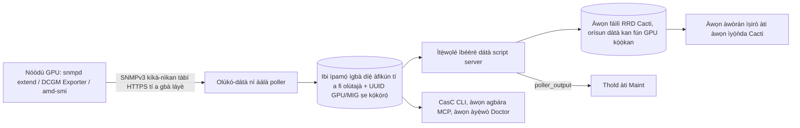

<!-- Source: README.md; SHA256: 97ba37df4a883426d3984ed7d14547ad7367e973411a8abd930409ce259f545b -->

<!-- translations:start -->
[English](../../../README.md) | [简体中文](../zh-CN/README.md) | [हिन्दी](../hi-IN/README.md) | [Español (España)](../es-ES/README.md) | [Español (Latinoamérica)](../es-419/README.md) | [العربية (السعودية)](../ar-SA/README.md) | [Afrikaans](../af-ZA/README.md) | [አማርኛ](../am-ET/README.md) | [العربية (مصر)](../ar-EG/README.md) | [العربية (المغرب)](../ar-MA/README.md) | [Български](../bg-BG/README.md) | [বাংলা](../bn-BD/README.md) | [Bosanski](../bs-BA/README.md) | [Deutsch](../de-DE/README.md) | [Ελληνικά](../el-GR/README.md) | [فارسی](../fa-IR/README.md) | [Filipino](../fil-PH/README.md) | [Français](../fr-FR/README.md) | [Français (Maroc)](../fr-MA/README.md) | [Français (Sénégal)](../fr-SN/README.md) | [Hausa](../ha-NG/README.md) | [עברית](../he-IL/README.md) | [Hrvatski](../hr-HR/README.md) | [Bahasa Indonesia](../id-ID/README.md) | [Igbo](../ig-NG/README.md) | [Italiano](../it-IT/README.md) | [日本語](../ja-JP/README.md) | [ქართული](../ka-GE/README.md) | [한국어](../ko-KR/README.md) | [Latviešu](../lv-LV/README.md) | [Malagasy](../mg-MG/README.md) | [मराठी](../mr-IN/README.md) | [Bahasa Melayu](../ms-MY/README.md) | [Nederlands](../nl-NL/README.md) | [Polski](../pl-PL/README.md) | [Português (Brasil)](../pt-BR/README.md) | [Português (Portugal)](../pt-PT/README.md) | [Русский](../ru-RU/README.md) | [Kinyarwanda](../rw-RW/README.md) | [Soomaali](../so-SO/README.md) | [Српски](../sr-RS/README.md) | [Svenska](../sv-SE/README.md) | [Kiswahili](../sw-KE/README.md) | [தமிழ்](../ta-IN/README.md) | [తెలుగు](../te-IN/README.md) | [ไทย](../th-TH/README.md) | [Türkçe](../tr-TR/README.md) | [Українська](../uk-UA/README.md) | [اردو](../ur-PK/README.md) | [Tiếng Việt](../vi-VN/README.md) | [isiXhosa](../xh-ZA/README.md) | [Yorùbá](README.md) | [繁體中文](../zh-TW/README.md) | [isiZulu](../zu-ZA/README.md)
<!-- translations:end -->

# plugin_gpu

Àfikún Cacti 1.2 kan tí ó ń mú ìlò fún GPU kọ̀ọ̀kan, ìrántí, ìwọ̀n ooru, agbára, àṣìṣe ECC, àti àwọn ìdí ìdínkù iyára láti inú àwọn irinṣẹ́ NVIDIA àti AMD wọ inú Cacti. GPU kọ̀ọ̀kan (tàbí ẹ̀ka MIG) di àtọ́ka ìbéèrè dátà lórí ẹ̀rọ nóòdù rẹ̀, nítorí náà àwọn àwòrán ìṣirò GPU jókòó lẹ́gbẹ̀ẹ́ àwọn àwòrán ìṣirò mìíràn ti nóòdù náà lábẹ́ àwọn ìyọ̀ǹda Cacti, bẹ́ẹ̀ sì ni Thold àti Maint lè fi ìkìlọ̀ ránṣẹ́ lórí wọn kí wọ́n sì dá wọn dúró.

> **Ipò: ìpele 1 dé 3 ni a ti ṣe àgbékalẹ̀ rẹ̀ nínú kóòdù, a kò tíì tú u jáde.** Ìpele 1 (`nvidia-smi` NVIDIA nípasẹ̀ SNMP extend, ìtọpinpin ìdánimọ̀, àwọn àwòrán ìṣirò, àmì ìdínkù iyára àti ECC, ìfitọ́nilétí Thold àti Maint, ojú-ewé ìlera), Ìpele 2 (olùtúpalẹ̀/oníbàárà kíkà-nìkan ti NVIDIA DCGM Exporter HTTP(S) àti olùtúpalẹ̀ AMD `amd-smi`), Ìpele 3 (ìtọpinpin ìdánimọ̀ ẹ̀ka MIG, àwọn òpó Schema v4, ṣíṣe olùkó-dátà òkèèrè ní ààlà poller, àwọn ìkọ́ `replicate_out` àti `remote_agent`), CLI olùṣiṣẹ́ CasC (`cli/gpu.php`), àti àwọn ìkọ́ ètò ìṣiṣẹ́ (`abilities_register`, `doctor_register_checks`, `casc_register_providers`) ni a ti ṣe àgbékalẹ̀ wọn tí a sì ti fi àyẹ̀wò ẹyọkan, ààbò, àti ìdàpọ̀ Cacti àlòkù bo wọ́n. Àwọn ìṣiṣẹ́ gidi títí di ìsinsìnyí lo `snmpd` àtọwọ́dá àti àwọn àpẹẹrẹ dátà dípò ohun èlò GPU gidi. Ohun tí ó ṣì wà ní ṣíṣí kí a tó fi àmì ìtújáde sí i: àyẹ̀wò àkọ́ṣe lórí ohun èlò gidi ([docs/pilot-plan.md](../../pilot-plan.md), #54), àyẹ̀wò ààbò láti òde ([docs/security-review.md](../../security-review.md)), àwọn àpẹẹrẹ dátà tí a mú láti inú àwọn irinṣẹ́ gidi (#14), àti ìwọ̀n agbára ìṣiṣẹ́ tí a díwọ̀n lórí ohun èlò tó tóbi bíi ti ìṣelọ́pọ̀ ([docs/performance.md](../../performance.md)). Ìkójọpọ̀ àṣìṣe XID ṣì wà ní ṣíṣí lábẹ́ ìpinnu #8.

## Àwọn ipa ìwọlé

| Agbègbè ìwọlé | Ìwọlé |
| --- | --- |
| Ìwòye GPU | Àwọn ojú-ewé àbójútó tí ó wà tẹ́lẹ̀. |
| Olùṣiṣẹ́ GPU | Àbójútó pẹ̀lú ojú-ewé Àwọn Iṣẹ́ àti ìjẹ́wọ́ ìtọ́jú ara-ẹni. |
| Alámòójútó GPU | Ìwọlé Olùṣiṣẹ́ pẹ̀lú ìṣètò àti àwọn ìgbésẹ̀ àmójútó tí ó wà tẹ́lẹ̀. |

Lẹ́yìn tí o bá ti ṣàdàkọ àwọn fáìlì ìgbéga, ṣí ojú-ewé Àwọn Àfikún gẹ́gẹ́ bí alámòójútó láti forúkọsílẹ̀
agbègbè ìwọlé tuntun náà. Yan agbègbè Olùṣiṣẹ́ ní pàtó lábẹ́ **Ìṣètò > Àwọn Olùlò** tàbí àwọn ẹgbẹ́ olùlò.
Àwọn ìgbéga ń pa àwọn ID agbègbè Ìwòye àti Alámòójútó tí ó wà tẹ́lẹ̀ àti àwọn ẹ̀bùn ìyọ̀ǹda mọ́. Ìwọlé Alámòójútó
ń jogún ìwọlé Olùṣiṣẹ́, ìwọlé Olùṣiṣẹ́ sì ń jogún ìwọlé Ìwòye lórí ìbéèrè kọ̀ọ̀kan;
èyí kò fi àwọn ẹ̀bùn ìyọ̀ǹda tí a tọ́jú kún un fún àwọn olùlò tàbí àwọn ẹgbẹ́. Àwọn ètò àfikún tún nílò
ìwọlé Alámòójútó GPU ní àfikún sí ìyọ̀ǹda Ètò ti Cacti.

Àwọn ìyọ̀ǹda ẹ̀rọ Cacti ṣì ń ṣàkóso àwọn ìlà àti àwọn ìgbésẹ̀ tí ó wà fún olùlò kọ̀ọ̀kan; àwọn ohun tí a kò so pọ̀ nílò alámòójútó.
Àwọn ìwé-ẹ̀rí ìwọlé, ìṣètò, ìsopọ̀, ìparẹ́ àti àwọn àyípadà àmójútó mìíràn
wà nínú àwọn ojú-ewé àmójútó. Àwọn ìjẹ́wọ́ ń wà fún ìgbà ìṣiṣẹ́ olùlò lọ́wọ́lọ́wọ́ nìkan,
fún wákàtí kan ní púpọ̀ jùlọ àti nígbà tí àkíyèsí kan náà bá ṣì jẹ́
tuntun. Àwọn àkíyèsí tuntun tàbí tí ó yípadà máa ń sọ wọ́n di aláìníláárí. Wọn kì í fi ìwọ̀n tí ó kùnà
ṣe bíi pé ó dáa tàbí kí wọ́n dá àwọn ìkìlọ̀ dúró rí.

## Ìdí rẹ̀

Àwọn nóòdù GPU sábà máa ń wà nínú Cacti tẹ́lẹ̀ fún CPU, ìrántí, àti àwọn ojú-ìbánisọ̀rọ̀ nẹ́tíwọ́ọ̀kì. Ìlera GPU jẹ́ ọ̀ràn ọ̀tọ̀ tí dátà SNMP ti nóòdù náà kò dáhùn: káàdì kan lè ní ìdínkù iyára nítorí ooru, ó lè kó àwọn àṣìṣe ECC jọ, tàbí kí ó ròyìn àbùkù XID nígbà tí nóòdù náà fúnra rẹ̀ dà bíi pé ó wà ní ìlera. Àwọn irinṣẹ́ olùtajà máa ń ròyìn rẹ̀ (`nvidia-smi`, DCGM, `amd-smi`), ṣùgbọ́n àbájáde wọn wà lóde àwọn àwòrán ìṣirò, àwọn ìyọ̀ǹda, àti ìfitọ́nilétí ti Cacti.

Àfikún náà dí àlàfo yẹn nípa yíyí àbájáde irinṣẹ́ olùtajà padà sí àwọn orísun dátà Cacti, tí a fi ìdánimọ̀ GPU kọ̀ọ̀kan ṣe kọ́kọ́rọ́ dípò ipò rẹ̀, kí àtúnbẹ̀rẹ̀ tí ó tún ìtòlẹ́sẹẹsẹ àwọn GPU ṣe má baà so ìtàn káàdì kan mọ́ òmíràn. Ó tún lo ètò yíya àwòrán ìṣirò, àwọn ìyọ̀ǹda, àwọn olùkó-dátà òkèèrè, Thold, àti Maint ti Cacti dípò kíkọ́ irú wọn mìíràn lọ́tọ̀.

## Ààlà iṣẹ́ tí a gbèrò

| Ìpele | Ààlà iṣẹ́ | Ipò | Àwọn Àṣeyọrí |
|---|---|---|---|
| 0, ìwádìí | Àbájáde irinṣẹ́ olùtajà, àwọn àmì XID àti ìdínkù iyára, ìdánimọ̀ GPU, àwọn àǹfààní ìwọlé, ìpinnu ọ̀nà ìkójọpọ̀ | Ti parí | [M1](https://github.com/somethingwithproof/plugin_gpu/milestone/1) |
| 1, nvidia | Ìkójọpọ̀ `nvidia-smi`, àkójọpọ̀ nípasẹ̀ UUID, àwọn àwòrán ìṣirò, àwọn àmì ìdínkù iyára àti ECC, Thold àti Maint, ojú-ewé ìlera | Ti ṣàgbékalẹ̀ (a dán wò pẹ̀lú àpẹẹrẹ) | [M2](https://github.com/somethingwithproof/plugin_gpu/milestone/2), [M3](https://github.com/somethingwithproof/plugin_gpu/milestone/3), [M4](https://github.com/somethingwithproof/plugin_gpu/milestone/4) |
| 2, àwọn ẹ̀rọ ìpìlẹ̀ | Olùtúpalẹ̀/oníbàárà kíkà-nìkan DCGM Exporter HTTP(S) (`lib/DcgmExporterParser.php`, `lib/DcgmExporterClient.php`), olùtúpalẹ̀ AMD `amd-smi` (`lib/AmdSmiParser.php`) | Ti ṣàgbékalẹ̀ (a dán wò ní ẹyọkan) | [M5](https://github.com/somethingwithproof/plugin_gpu/milestone/5) |
| 3, mig, òkèèrè, àti ètò ìṣiṣẹ́ | Ìtọpinpin ìdánimọ̀ ẹ̀ka MIG, àwọn olùkó-dátà òkèèrè (`INFO`, `poller_gpu.php --poller=N`, `replicate_out`, `remote_agent`), CasC CLI (`cli/gpu.php`), àwọn ìkọ́ MCP/Doctor/CasC | Ti ṣàgbékalẹ̀ (a dán wò ní ẹyọkan àti ìdàpọ̀ CI) | [M6](https://github.com/somethingwithproof/plugin_gpu/milestone/6) |

Ó wà lóde ààlà iṣẹ́: èyíkéyìí àṣẹ tí ó ń yí GPU tàbí nóòdù padà (àwọn aago ìṣiṣẹ́, ààlà agbára, àtúntò, ìṣètò MIG), ẹ̀rọ ìfitọ́nilétí tí àfikún ní, daemon àdáni tàbí ìlànà nẹ́tíwọ́ọ̀kì, àti ìṣirò olùṣètò tàbí iṣẹ́. Wo ètò náà fún àkójọ iṣẹ́ ìwádìí tí ó ṣẹ́kù.

## Ohun tí àṣeyọrí 4 fi kún un

- **Olùkó-dátà kíkà-nìkan ti NVIDIA DCGM Exporter** (`lib/DcgmExporterParser.php`, `lib/DcgmExporterClient.php`). Ó ń túpalẹ̀ àwọn ìwọ̀n ọ̀rọ̀ Prometheus (`DCGM_FI_DEV_GPU_UTIL`, `DCGM_FI_DEV_FB_USED`, `DCGM_FI_DEV_FB_FREE`, `DCGM_FI_DEV_POWER_USAGE`, `DCGM_FI_DEV_GPU_TEMP`, `DCGM_FI_DEV_ECC_DBE_VOL_TOTAL`, `DCGM_FI_DEV_CLOCK_THROTTLE_REASONS`, àti àwọn àmì MIG `GPU_I_ID` àti `GPU_I_PROFILE`). Oníbàárà HTTP(S) ń fi àtòjọ olùpèsè/CIDR tí a gbà láyè ní pàtó múlẹ̀, ó ń ṣàyẹ̀wò àwọn ìwé-ẹ̀rí TLS ní àìyípadà, ó ń fi ààlà sí àkókò ìdádúró àti ìwọ̀n ìdáhùn, ó ń pa àtúndarí, ó sì ń kọ̀ àwọn ìlànà tí kì í ṣe HTTP(S).
- **Olùtúpalẹ̀ kíkà-nìkan ti AMD `amd-smi`** (`lib/AmdSmiParser.php`). Ó ń ṣètò àbájáde JSON/SNMP-extend ti `amd-smi` (ìlò, VRAM, agbára, ìwọ̀n ooru junction/edge, ECC, dátà ìpín, àti àwọn olùkójọ ìdínkù iyára ọ̀tọ̀ọ̀tọ̀ nípasẹ̀ `Reading::$vendorExtensions`) sínú àpẹẹrẹ ìwọ̀n wọ́pọ̀ lábẹ́ `Vendor::Amd`.
- **Ìtọpinpin ẹ̀ka MIG àti Schema v4** (`lib/GpuReport.php`, `lib/GpuSnapshot.php`, `lib/GpuRecord.php`, `lib/Schema.php`, `lib/ScriptServer.php`). Ó ń tọpinpin àwọn UUID ẹ̀ka MIG (`MIG-<uuid>` àti `MIG-GPU-<parent>/<gi>/<ci>`), `mig_mode`, `mig_instance_id`, `mig_profile`, `parent_uuid`, àti `partition_info` lẹ́gbẹ̀ẹ́ àwọn GPU òbí nígbà tí ó ń dáàbò bo àwọn kọ́kọ́rọ́ ìdánimọ̀ tí kì í yípadà (`vendor`, `uuid`, `parent_uuid`) lórí àwọn àtúnṣe tí ó sì ń fìdí wọn múlẹ̀ ṣáájú àwọn ìbéèrè ibi ìpamọ́ dátà.
- **Àwọn olùkó-dátà òkèèrè** (`INFO`, `poller_gpu.php`, `lib/Poller.php`, `lib/ReplicationRepository.php`, `setup.php`). Ó ń kéde `remote_collect:1, remote_poller:1` nínú `INFO`, ó ń ṣe àtìlẹ́yìn fún ṣíṣe ní ààlà poller nípasẹ̀ `php plugins/gpu/poller_gpu.php --poller=N`, ó ń fò ṣíṣẹ̀dá ohun Cacti lórí àwọn poller tí kì í ṣe olórí, ó ń ṣe àdàkọ àwọn tábìlì ààlà poller nípasẹ̀ `replicate_out`, ó sì ń dáhùn àwọn ìgbésẹ̀ kíkà-nìkan `gpu_health` àti `gpu_inventory` nípasẹ̀ `remote_agent`.
- **CLI Olùṣiṣẹ́ àti CasC** (`cli/gpu.php`, `lib/CascProvider.php`). Ó ń ṣiṣẹ́ lórí PHP 8.2+ (ó ń túpalẹ̀ lórí PHP 8.0) láìsí ìgbẹ́kẹ̀lé Composer láti òde: `php plugins/gpu/cli/gpu.php export [--format=yaml|xml]`, `validate <file> [--format=yaml|xml]`, `plan <file> [--format=yaml|xml] [--output=text|json]`, `apply <file> --confirm=<PLAN_HASH> [--format=yaml|xml]`, àti `health [--format=text|json]`. Àwọn ètò ń ṣírò hash ìjẹ́rìísí SHA-256 tí ó dúró déédé, `apply` ń kùnà ní ààbò tí hash kò bá bára mu, bẹ́ẹ̀ sì ni ìtúpalẹ̀ XML ń kọ̀ àwọn ìkéde `DOCTYPE` àti `ENTITY`.
- **Àwọn ìkọ́ ìdàpọ̀ ètò ìṣiṣẹ́** (`lib/EcosystemIntegration.php`, `setup.php`). Ó ń forúkọsílẹ̀ `abilities_register` (`gpu-list-nodes`, `gpu-list-devices`, `gpu-get-health`; kíkà-nìkan, tí agbègbè ìwọlé `GPU View` àti àwọn ìyọ̀ǹda ẹ̀rọ Cacti ṣe ààbò rẹ̀), `doctor_register_checks` (`gpu_schema`, `gpu_poller_freshness`, `gpu_node_health`), àti `casc_register_providers`.
- **Àwọn ìdí ìdínkù iyára àti ECC gẹ́gẹ́ bí ìwọ̀n ìkìlọ̀** ([docs/metrics.md](../../metrics.md)). Ó ń túmọ̀ àwọn ibòjú ìṣẹ̀lẹ̀ aago sí àwọn àtọ́ka 0/1 ó sì ń ṣírò àwọn àṣìṣe ECC tuntun tí a túnṣe/tí a kò túnṣe fún àkókò kọ̀ọ̀kan gẹ́gẹ́ bí òṣùwọ̀n kí Thold 1.8.2 àti Maint 1.3 lè ta kìlọ̀ kí wọ́n sì dá a dúró láìsí òǹkà òdì tàbí ìfòkè àtúntò ([docs/alerting.md](../../alerting.md)).
- **Ìlera GPU, àwọn ìyọ̀ǹda, ìkùnà/ìmúpadàbọ̀sípò, àti ìwọ̀n agbára ìṣiṣẹ́.** Ìlera GPU (Ìwòye GPU) ń fi ìgbà tuntun tí a tọ́jú, àbájáde ìkójọpọ̀ tí ó kẹ́yìn, ipò Maint, ẹ̀rọ ìpìlẹ̀, àwọn ẹ̀ya, àti àwọn ibòjú ìdínkù iyára aise hàn láìkàn sí àwọn nóòdù. Àwọn àyẹ̀wò àkọsílẹ̀ láti ìbẹ̀rẹ̀ dé òpin ń fìdí àwọn ìyọ̀ǹda, ìmúpadàbọ̀sípò ìkùnà aṣojú/DB/RRD ([docs/backup.md](../../backup.md)), àti ìṣiṣẹ́ ìwọ̀n agbára GPU 100 nínú CI ([docs/performance.md](../../performance.md), [docs/operations.md](../../operations.md), [CHANGELOG.md](../../../CHANGELOG.md)) múlẹ̀.

## Ohun tí àṣeyọrí 3 fi kún un

- **Ìkójọpọ̀ nípasẹ̀ SNMP extend** ([ADR 0008](../../decisions/0008-collect-through-snmp-extend.md)). Alámòójútó nóòdù náà ń fi àwọn ìlà `extend` méjì tí a ti yàn kún `snmpd.conf` ([docs/node-setup.md](../../node-setup.md)); àfikún náà ń ka NET-SNMP-EXTEND-MIB nípasẹ̀ àwọn iṣẹ́ SNMP ti Cacti pẹ̀lú àwọn ìwé-ẹ̀rí ìwọlé ti ẹ̀rọ náà fúnra rẹ̀, a sì gbani nímọ̀ràn SNMPv3. Kò sí ohunkóhun tí ó ń ṣiṣẹ́ lórí olùpèsè Cacti tàbí nóòdù náà.
- **Ìtúpalẹ̀ tí ó múnádóko.** A ń ka àwọn pápá nípa ipò wọn, ìlà kọ̀ọ̀kan ń dárúkọ GPU rẹ̀ nípasẹ̀ UUID, bẹ́ẹ̀ sì ni ipò ìjáde tí kì í ṣe òdo, ìparí àkókò, àbájáde tí ó gé kúrú, ìlà tí ó ní iye pápá tí kò tọ́, tàbí ọ̀rọ̀ àṣìṣe tí ó dàpọ̀ máa ń sọ gbogbo ìkójọpọ̀ di ìkùnà: àwọn ìwọ̀n di `U`, kò sí GPU tí a sàmì sí pé kò sí níbẹ̀, àti pé Àwọn Nóòdù GPU ń fi ìdí rẹ̀ hàn.
- **Olùkó-dátà kan lẹ́yìn ìyípo poller kọ̀ọ̀kan.** Ó ń ka aṣojú nóòdù kọ̀ọ̀kan tí a mú ṣiṣẹ́, ó ń ṣàtúnṣe àwọn àkọsílẹ̀ ìdánimọ̀, ó sì ń fi àpẹẹrẹ tuntun jùlọ pamọ́ sí ibi ìpamọ́ ìgbà díẹ̀. Ìtẹ̀wọlé script server ń ka ibi ìpamọ́ ìgbà díẹ̀ yẹn nìkan, nítorí náà ìyẹ̀wò Cacti kì í dúró de nóòdù GPU kan rí.
- **Àwọn ohun Cacti** ([ADR 0010](../../decisions/0010-attach-to-existing-node-devices.md)). Àwọn àdàkọ àti ìbéèrè dátà *GPU - Àwọn Ẹ̀rọ* máa ń wá gẹ́gẹ́ bí XML, a sì ń kó wọn wọlé nígbà ìfisílẹ̀ àti ìgbéga. Fífipamọ́ nóòdù kan ń so ìbéèrè dátà pọ̀ mọ́ ẹ̀rọ rẹ̀ tí ó wà tẹ́lẹ̀ pẹ̀lú ọ̀nà àtúnṣe àtọ́ka Kò sí; Àwọn Nóòdù GPU lè ṣẹ̀dá ẹ̀rọ kan nígbà tí nóòdù náà kò bá ní kankan nìkan. GPU kọ̀ọ̀kan jẹ́ àtọ́ka tí a fi olùtajà àti UUID ṣe kọ́kọ́rọ́ rẹ̀, pẹ̀lú orísun dátà kan tí àwọn àwòrán ìṣirò Ìlò, Ìrántí, Ìwọ̀n Ooru, Agbára, Ìdá-ọgọ́rùn-ún Agbára, Àwọn Aago Ìṣiṣẹ́, Ìdínkù Iyára, Àwọn Àṣìṣe ECC, Àwọn Àṣìṣe ECC Tuntun, Àwọn Ojú-ewé Tí Ó Fẹ̀yìntì, àti Ọjọ́-orí Àpẹẹrẹ rẹ̀ ń pín. A ń ya gbogbo pápá àpẹẹrẹ nípasẹ̀ àwòrán ìṣirò kan, nítorí pé Cacti ń tọ́jú àwọn pápá tí àwòrán ìṣirò bá lò nìkan. Àfikún náà ń tún àtọ́ka ṣe lẹ́yìn gbogbo àyípadà GPU, ó ń pa àtúnṣe àtọ́ka tí Cacti fò mọ́ nígbà tí ẹ̀rọ náà wà Ní Ìsàlẹ̀ tàbí tí a mú kúrò ní ṣíṣẹ́, ó sì ń ṣiṣẹ́ rẹ̀ ní kété tí ẹ̀rọ náà bá wà Lókè, ó sì ń ṣẹ̀dá àwọn àwòrán ìṣirò fún àwọn GPU tuntun.
- **Ìtàn ń dúró pẹ̀lú káàdì náà.** GPU tí kò sí níbẹ̀ ń dúró gẹ́gẹ́ bí àtọ́ka, nítorí náà àwọn àwòrán ìṣirò rẹ̀ ń fi àlàfo hàn, wọ́n sì ń tẹ̀síwájú nínú fáìlì RRD kan náà nígbà tí ó bá padà. Káàdì tí a fi rọ́pò rẹ̀ nínú ihò kan náà ń gba orísun dátà tirẹ̀. **Yọ kúrò nínú Ìbéèrè Dátà** lórí ojú-ewé nóòdù náà ń yọ GPU tí kò sí níbẹ̀ kúrò nínú àkójọ; a ń pa àwọn fáìlì RRD àti àwọn àwòrán ìṣirò rẹ̀ mọ́ títí tí o fi pa wọ́n rẹ́.
- **Àwọn ìyọ̀ǹda ẹ̀rọ lórí Àwọn Nóòdù GPU.** Alámòójútó GPU ń rí, ń yípadà, ń kó jáde, ó sì ń gbé àwọn nóòdù àti GPU tí ó wà lórí àwọn ẹ̀rọ tí wọ́n lè rí nínú Cacti nìkan; gbígbé GPU kan nílò àwọn nóòdù méjèèjì. A lè mú nóòdù tí a ti pa ẹ̀rọ rẹ̀ rẹ́ kúrò ní ṣíṣẹ́ tàbí kí a pa á rẹ́.
- **Àpẹẹrẹ ìwọ̀n wọ́pọ̀** ([ADR 0009](../../decisions/0009-common-metric-core-with-vendor-extensions.md), [docs/metrics.md](../../metrics.md)). Ìrántí wà ní bytes, a túmọ̀ ibòjú ìṣẹ̀lẹ̀ aago sí àwọn àtọ́ka `thr_*`, bẹ́ẹ̀ sì ni `age` jẹ́ ọjọ́-orí àkókò àpẹẹrẹ ti GPU fúnra rẹ̀, tàbí `U` nígbà tí a kò bá mọ̀ ọ́n.

Olùlò tí ó ń fi sórí ẹ̀rọ (olùpèsè wẹ́ẹ̀bù) gbọ́dọ̀ lè kọ sí `<cacti>/resource/script_server/`, níbi tí àfikún náà ti ń gbé XML ìbéèrè dátà rẹ̀ sí; bí bẹ́ẹ̀ kọ́, ìfisílẹ̀ àti ìgbéga yóò dúró pẹ̀lú ìfiránṣẹ́, yóò sì tún gbìyànjú ní ìgbìyànjú tí ó tẹ̀lé e. Ìyọkúrò ń yọ àwọn àdàkọ àti XML kúrò nígbà tí a bá fi àmì sí *Yọ àwọn ohun Cacti ti àfikún kúrò nígbà ìyọkúrò* nìkan, kì í sì í pa àwọn fáìlì RRD, àwọn ẹ̀rọ, àwọn àwòrán ìṣirò, tàbí àwọn orísun dátà rẹ́ rí ([docs/operations.md](../../operations.md#uninstall)). Àwọn nóòdù lórí àwọn olùkó-dátà òkèèrè ń ṣiṣẹ́ ní ààlà `poller_id` tí a yàn fún wọn.

## Ohun tí àṣeyọrí 2 mú wá

- **Ìfisílẹ̀ tí a ṣọ́.** Lórí PHP tí ó wà ní ìsàlẹ̀ 8.2, a kọ̀ láti fi sílẹ̀ àti láti mú ṣiṣẹ́ pẹ̀lú ìfiránṣẹ́ tí ó dárúkọ ẹ̀ya tí a nílò, àti pé ìyókù Cacti ń bá iṣẹ́ rẹ̀ lọ. `setup.php` àti àwọn ìwé-àṣẹ ojú-ewé ń túpalẹ̀ lórí PHP 8.0.
- **Ìgbésẹ̀ ayé iṣẹ́.** Fi sílẹ̀, gbéga, mú kúrò ní ṣíṣẹ́, kí o sì yọ kúrò nípasẹ̀ ojú-ewé Àwọn Àfikún ti Cacti. Àwọn ìgbéga wà ní ìtòlẹ́sẹẹsẹ, wọ́n ń parí lẹ́yìn ìdènà, wọ́n sì ń yí ẹ̀ya tí a kọ sílẹ̀ padà lẹ́yìn tí wọ́n bá ṣàṣeyọrí nìkan. Ìyọkúrò ń pa àwọn tábìlì àfikún mọ́ àyàfi tí o bá pa *Pa Àwọn Tábìlì Àfikún Mọ́ nígbà Ìyọkúrò* rẹ́; kì í fọwọ́ kan ẹ̀rọ Cacti, orísun dátà, àwòrán ìṣirò, tàbí fáìlì RRD rí.
- **Àwọn agbègbè ìwọlé ọ̀tọ̀ọ̀tọ̀.** *Alámòójútó GPU* ń ṣí **Àwọn Nóòdù GPU**, níbi tí o ti ń forúkọsílẹ̀ àwọn ẹ̀rọ Cacti gẹ́gẹ́ bí àwọn nóòdù GPU, tí o ń fọwọ́ sí tàbí kọ̀ láti gbé GPU láàárín àwọn nóòdù, tí o sì ń kó gbogbo àkọsílẹ̀ jáde gẹ́gẹ́ bí JSON. *Ìwòye GPU* ń ṣí **Àkójọ GPU**, tí ó ń ṣe àkójọ àwọn GPU lórí àwọn ẹ̀rọ tí olùwòye lè rí nìkan. Àwọn ojú-ewé méjèèjì wà lábẹ́ Ìṣàkóso, bẹ́ẹ̀ sì ni gbogbo àyípadà jẹ́ POST tí csrf-magic ń ṣàyẹ̀wò.
- **Àwọn àkọsílẹ̀ ìdánimọ̀ GPU.** A fi olùtajà àti UUID ṣe kọ́kọ́rọ́ GPU kọ̀ọ̀kan. Àtọ́ka, ID bọ́ọ̀sì PCI, orúkọ, awakọ̀, àti irinṣẹ́ ìròyìn jẹ́ àwọn ànímọ́ tí ó ń yípadà ní ibi kan náà. A ń fi àmì sí UUID tuntun nínú ihò tí a mọ̀ gẹ́gẹ́ bí ìrọ́pò tí ó ṣeé ṣe, ó sì ń bẹ̀rẹ̀ ìtàn tirẹ̀; GPU tí a rí ní nóòdù mìíràn ń gbé ipò nígbà tí olùṣiṣẹ́ bá fọwọ́ sí i nìkan; GPU tí ó sọnù láti inú àwọn ìkójọpọ̀ tí ó ṣàṣeyọrí ni a sàmì sí pé kò sí níbẹ̀ lẹ́yìn iye tí a lè ṣètò, a kò sì í pa á rẹ́ rí. Àwọn UUID gbogbo-GPU ti NVIDIA nìkan ni a gbà lọ́wọ́lọ́wọ́; àwọn ẹ̀ka MIG ń dúró de ìpinnu #13, bẹ́ẹ̀ sì ni AMD ń dúró de ìwádìí #19. Àwọn ìlànà náà ni a fi àwọn àtẹ̀lé àpẹẹrẹ dátà dán wò, níwọ̀n bí kò tíì sí olùkó-dátà tí ó ń fún wọn ní dátà síbẹ̀.
- **Àwọn àyẹ̀wò àti CI.** Àwọn àkójọ àyẹ̀wò ẹyọkan àti ìlànà orísun láìsí GPU tàbí ibi ìpamọ́ dátà, àwọn àyẹ̀wò ìgbésẹ̀ ayé àti ìyọ̀ǹda ojú-ewé lòdì sí Cacti 1.2.31 àti 1.2.x lọ́wọ́lọ́wọ́ lórí PHP 8.2 sí 8.5, iṣẹ́ ìkọ̀sílẹ̀ PHP 8.1 kan, àyẹ̀wò PHP 8.0 ti àwọn ojú-ọ̀nà ìbẹ̀rẹ̀, PHPStan ní ìpele 9, àti REUSE. Ètò àyẹ̀wò náà jẹ́ ti ìgbà díẹ̀ títí tí a fi pinnu #12.

### Ìfisílẹ̀ fún ìdánwò

Àwọn ìgbésẹ̀ wọ̀nyí ń fi kóòdù lọ́wọ́lọ́wọ́ sílẹ̀ láti dán an wò; [docs/operations.md](../../operations.md) ní ìtọ́sọ́nà olùṣiṣẹ́ ní kíkún. Wọ́n nílò Cacti 1.2.31 tàbí ẹ̀ya tuntun síi lórí PHP 8.2 tàbí ẹ̀ya tuntun síi.

1. Ṣàdàkọ ibi ìpamọ́ kóòdù náà sí `plugins/gpu` lábẹ́ àpò Cacti rẹ. Àpò náà gbọ́dọ̀ jẹ́ `gpu`.
2. Nínú Cacti, ṣí **Ìṣètò > Àwọn Àfikún**, lẹ́yìn náà fi **GPU** sílẹ̀ kí o sì mú un ṣiṣẹ́.
3. Fún àwọn olùlò ní agbègbè ìwọlé *Ìwòye GPU*, *Olùṣiṣẹ́ GPU*, tàbí *Alámòójútó GPU* lábẹ́ **Ìṣètò > Àwọn Olùlò**, gẹ́gẹ́ bí ipa wọn. Olùlò tí ó ń fi sílẹ̀ ń gba Ìwòye àti Alámòójútó; Alámòójútó ní ìwọlé Olùṣiṣẹ́ nínú.
4. Ṣètò aṣojú SNMP ti nóòdù GPU kọ̀ọ̀kan bí a ṣe ṣàlàyé rẹ̀ nínú [docs/node-setup.md](../../node-setup.md), lẹ́yìn náà fi nóòdù náà kún un lábẹ́ **Ìṣàkóso > Àwọn Nóòdù GPU**.
5. Fún àwọn ìkìlọ̀, kó àwọn àdàkọ Thold tí a fi ránṣẹ́ wọlé bí [docs/alerting.md](../../alerting.md) ṣe ṣàpèjúwe rẹ̀.
6. Bí o bá fẹ́, ṣàtúnṣe **Ìṣètò > Àwọn Ètò > GPU**: *Sàmì Sí Kò Sí Níbẹ̀ Lẹ́yìn* (àìyípadà jẹ́ ìkójọpọ̀ 3 tí ó ṣàṣeyọrí, láti 1 sí 100), *Di Àtijọ́ Lẹ́yìn* (bí àpẹẹrẹ ṣe lè pẹ́ tó kí àwọn ìwọ̀n rẹ̀ tó tẹ `U` jáde), àti *Pa Àwọn Tábìlì Àfikún Mọ́ nígbà Ìyọkúrò* (àìyípadà wà ní títàn).

## Bí àwọn ìwọ̀n ṣe ń dé inú Cacti

Ìpinnu [#7](https://github.com/somethingwithproof/plugin_gpu/issues/7) yan SNMP `extend` ([ADR 0008](../../decisions/0008-collect-through-snmp-extend.md)): aṣojú ti nóòdù fúnra rẹ̀ ń ṣiṣẹ́ àṣẹ `nvidia-smi` tí a ti yàn, àfikún náà sì ń ka àbájáde rẹ̀ nìkan. Ètò náà ṣe ìfiwéra àwọn àṣàyàn lábẹ́ [Àwọn ọ̀nà ìkójọpọ̀](../../PLAN.md#collection-paths).

## Àwọn àfojúsùn ìbámu

| Ẹ̀yà | Àfojúsùn |
|---|---|
| Cacti | 1.2.31 tàbí ẹ̀ya tuntun síi, kò sí àtúnṣe kóòdù ìpìlẹ̀ |
| PHP | 8.2 tàbí ẹ̀ya tuntun síi; `setup.php` ṣì lè túpalẹ̀ lórí 8.0 kí àyíká ìṣiṣẹ́ tí a kò ṣe àtìlẹ́yìn fún rí ìkọ̀sílẹ̀ dípò ojú-ìbánisọ̀rọ̀ Cacti tí ó bàjẹ́ |
| NVIDIA | Àwọn ẹ̀ka awakọ̀ àti irinṣẹ́ tí ìwádìí [#26](https://github.com/somethingwithproof/plugin_gpu/issues/26) yóò ṣètò; a ṣàyẹ̀wò àwọn ID pápá DCGM ní v3.3.9 àti v4.7.0 |
| AMD | `amd-smi` lórí àwọn ìtúsílẹ̀ ROCm tí ìwádìí [#26](https://github.com/somethingwithproof/plugin_gpu/issues/26) yóò ṣètò |
| Thold, Maint | Thold 1.8.2 àti Maint 1.3, tí a kò yípadà, tí a dán wò láti ìbẹ̀rẹ̀ dé òpin ([docs/alerting.md](../../alerting.md)) |

## Ìgbékalẹ̀

- [docs/PLAN.md](../../PLAN.md) ni ètò náà ní kíkún: ìṣètò àwòrán, àwọn òtítọ́ òkè tí ó gbára lé (pẹ̀lú àwọn orísun), àpẹẹrẹ ìdánimọ̀, àwọn ààlà ààbò, ìṣirò agbára ìṣiṣẹ́, àyẹ̀wò, àti àwọn ewu.
- [docs/decisions/](../../decisions) ní àwọn àkọsílẹ̀ ìpinnu ìṣètò fún àwọn yíyàn tí a ti ṣe tẹ́lẹ̀.
- [docs/REQUIREMENTS.md](../../REQUIREMENTS.md) ń so gbogbo ID ìbéèrè pọ̀ mọ́ ọ̀rọ̀ rẹ̀.

## Bí a ṣe ń tọpinpin iṣẹ́

- **Àwọn Àṣeyọrí** ń tẹ̀lé àwọn àṣeyọrí ètò náà. Ọ̀kọ̀ọ̀kan ní ọ̀rọ̀ àkọ́kọ́ nlá tí ó ṣe àkójọ àwọn ọ̀rọ̀ abẹ́ rẹ̀ àti ẹ̀rí ìparí.
- **Àwọn Ọ̀rọ̀** jẹ́ títò nípa àmì: `type: requirement`, `type: research`, `type: decision`, `type: epic`. Àwọn ọ̀rọ̀ ìbéèrè ń sọ àwọn ìbéèrè tí a lè dán wò tí ó ní nọ́ńbà (`REQ-AREA-NNN`) àti àwọn ìlànà ìtẹ́wọ́gbà.
- **Àwọn Àmì** tún ní `area:`, `phase:`, `priority:`, àti `status:`. Wo [CONTRIBUTING.md](../../../CONTRIBUTING.md#labels).
- [Pátákó iṣẹ́ àkànṣe](https://github.com/users/somethingwithproof/projects/9) ń fi gbogbo àwọn ọ̀rọ̀ hàn kọjá àwọn àṣeyọrí.

## Ìkópa

Ka [CONTRIBUTING.md](../../../CONTRIBUTING.md). Àwọn ìfiwọlé kóòdù nílò ìfọwọ́sowọ́pọ̀ DCO. Ìjíròrò ìṣètò ń ṣẹlẹ̀ lórí àwọn ọ̀rọ̀; àwọn ìpinnu tí ó ṣí sílẹ̀ ní àmì `type: decision`. Àbájáde tí a mú láti inú àwọn irinṣẹ́ GPU gidi ni ìkópa tí ó wúlò jùlọ sí àṣeyọrí 1; yọ àwọn orúkọ olùpèsè, àwọn nọ́ńbà tẹ̀léntẹ̀lé, àti àwọn UUID kúrò ní àkọ́kọ́.

## Ààbò

Ròyìn àwọn àìlera ààbò ní ìkọ̀kọ̀; wo [SECURITY.md](../../../SECURITY.md).

## Ìwé-àṣẹ

GNU General Public License v2.0, ìwé-àṣẹ kan náà pẹ̀lú Cacti àti àwọn àfikún rẹ̀. Wo [LICENSE](../../../LICENSE).
