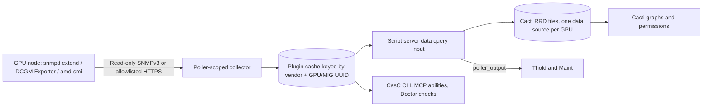

<!-- Source: README.md; SHA256: 97ba37df4a883426d3984ed7d14547ad7367e973411a8abd930409ce259f545b -->

<!-- translations:start -->
[English](../../../README.md) | [简体中文](README.md) | [हिन्दी](../hi-IN/README.md) | [Español (España)](../es-ES/README.md) | [Español (Latinoamérica)](../es-419/README.md) | [العربية (السعودية)](../ar-SA/README.md) | [Afrikaans](../af-ZA/README.md) | [አማርኛ](../am-ET/README.md) | [العربية (مصر)](../ar-EG/README.md) | [العربية (المغرب)](../ar-MA/README.md) | [Български](../bg-BG/README.md) | [বাংলা](../bn-BD/README.md) | [Bosanski](../bs-BA/README.md) | [Deutsch](../de-DE/README.md) | [Ελληνικά](../el-GR/README.md) | [فارسی](../fa-IR/README.md) | [Filipino](../fil-PH/README.md) | [Français](../fr-FR/README.md) | [Français (Maroc)](../fr-MA/README.md) | [Français (Sénégal)](../fr-SN/README.md) | [Hausa](../ha-NG/README.md) | [עברית](../he-IL/README.md) | [Hrvatski](../hr-HR/README.md) | [Bahasa Indonesia](../id-ID/README.md) | [Igbo](../ig-NG/README.md) | [Italiano](../it-IT/README.md) | [日本語](../ja-JP/README.md) | [ქართული](../ka-GE/README.md) | [한국어](../ko-KR/README.md) | [Latviešu](../lv-LV/README.md) | [Malagasy](../mg-MG/README.md) | [मराठी](../mr-IN/README.md) | [Bahasa Melayu](../ms-MY/README.md) | [Nederlands](../nl-NL/README.md) | [Polski](../pl-PL/README.md) | [Português (Brasil)](../pt-BR/README.md) | [Português (Portugal)](../pt-PT/README.md) | [Русский](../ru-RU/README.md) | [Kinyarwanda](../rw-RW/README.md) | [Soomaali](../so-SO/README.md) | [Српски](../sr-RS/README.md) | [Svenska](../sv-SE/README.md) | [Kiswahili](../sw-KE/README.md) | [தமிழ்](../ta-IN/README.md) | [తెలుగు](../te-IN/README.md) | [ไทย](../th-TH/README.md) | [Türkçe](../tr-TR/README.md) | [Українська](../uk-UA/README.md) | [اردو](../ur-PK/README.md) | [Tiếng Việt](../vi-VN/README.md) | [isiXhosa](../xh-ZA/README.md) | [Yorùbá](../yo-NG/README.md) | [繁體中文](../zh-TW/README.md) | [isiZulu](../zu-ZA/README.md)
<!-- translations:end -->

# plugin_gpu

一个 Cacti 1.2 插件，将 NVIDIA 和 AMD 工具提供的每 GPU 利用率、内存、温度、功率、ECC 错误和降频原因引入 Cacti。每块 GPU（或 MIG 实例）成为其节点设备上数据查询的一个索引，因此 GPU 图表与节点的其他图表共用 Cacti 权限，Thold 和 Maint 可以对其告警并抑制告警。

> **状态：阶段 1 至 3 已在代码中实现，尚未发布。** 阶段 1（通过 SNMP extend 采集 NVIDIA `nvidia-smi`、身份跟踪、图表、降频和 ECC 信号、Thold 与 Maint 告警、健康页面）、阶段 2（只读 NVIDIA DCGM Exporter HTTP(S) 解析器/客户端和 AMD `amd-smi` 解析器）、阶段 3（MIG 实例身份跟踪、Schema v4 列、按轮询器作用域执行的远程采集器、`replicate_out` 和 `remote_agent` 钩子）、CasC 操作员命令行工具（`cli/gpu.php`）以及生态集成钩子（`abilities_register`、`doctor_register_checks`、`casc_register_providers`）均已实现，并由单元测试、安全测试及一次性 Cacti 集成测试覆盖。迄今的实时运行使用的是合成 `snmpd` 与测试样本载荷，而非物理 GPU 硬件。标记发布前仍待完成：真实硬件试点（[docs/pilot-plan.md](../../pilot-plan.md)，#54）、外部安全审查（[docs/security-review.md](../../security-review.md)）、从真实工具捕获的测试样本（#14），以及生产规模硬件上的规模测量（[docs/performance.md](docs/performance.md)）。XID 错误采集仍在决策 #8 下待定。

## 访问角色

| 权限域 | 访问范围 |
| --- | --- |
| GPU View | 现有监控页面。 |
| GPU Operator | 监控，加上操作页面和个人分诊确认。 |
| GPU Admin | Operator 访问，加上现有配置和管理操作。 |

复制升级文件后，以管理员身份打开插件页面以注册新权限域。在 **配置 > 用户** 或用户组中显式分配 Operator 权限域。升级保留现有 View 和 Admin 权限域 ID 及授权。每个请求中，Admin 继承 Operator，Operator 继承 View；这不会为用户或组添加持久授权。插件设置除要求 Cacti 的 Settings 权限外，还要求 GPU Admin。

Cacti 设备权限继续限制每位用户可见的行和可执行操作；未映射对象需要管理员。凭据、配置、映射、删除及其他管理变更仍位于管理页面。确认仅持续于当前用户会话，最多一小时，且仅在同一观测仍新鲜时有效。新的或变化的观测会使其失效。确认绝不将失败测量标为健康，也不抑制告警。

## 为什么需要它

GPU 节点通常已在 Cacti 中监控 CPU、内存和接口。但 GPU 健康是节点 SNMP 数据无法回答的另一个问题：卡可能因温度降频、累积 ECC 错误或报告 XID 故障，而节点本身看似健康。厂商工具（`nvidia-smi`、DCGM、`amd-smi`）能报告这些情况，但其输出不在 Cacti 的图表、权限和告警体系内。

插件将厂商工具输出转换为 Cacti 数据源以填补这一缺口，按每块 GPU 的身份而非位置建立键，因此重启改变 GPU 顺序时，不会把一块卡的历史附到另一块卡上。它复用 Cacti 图表、权限、远程数据采集器、Thold 和 Maint，而非另建平行实现。

## 计划范围

| 阶段 | 范围 | 状态 | 里程碑 |
|---|---|---|---|
| 0，研究 | 厂商工具输出、XID 和降频信号、GPU 身份、权限、采集路径决策 | 已完成 | [M1](https://github.com/somethingwithproof/plugin_gpu/milestone/1) |
| 1，nvidia | `nvidia-smi` 采集、按 UUID 建立清单、图表、降频和 ECC 信号、Thold 与 Maint、健康页面 | 已实现（样本测试） | [M2](https://github.com/somethingwithproof/plugin_gpu/milestone/2)、[M3](https://github.com/somethingwithproof/plugin_gpu/milestone/3)、[M4](https://github.com/somethingwithproof/plugin_gpu/milestone/4) |
| 2，后端 | 只读 DCGM Exporter HTTP(S) 解析器/客户端（`lib/DcgmExporterParser.php`、`lib/DcgmExporterClient.php`）、AMD `amd-smi` 解析器（`lib/AmdSmiParser.php`） | 已实现（单元测试） | [M5](https://github.com/somethingwithproof/plugin_gpu/milestone/5) |
| 3，MIG、远程与生态 | MIG 实例身份跟踪、远程数据采集器（`INFO`、`poller_gpu.php --poller=N`、`replicate_out`、`remote_agent`）、CasC CLI（`cli/gpu.php`）、MCP/Doctor/CasC 钩子 | 已实现（单元与 CI 集成测试） | [M6](https://github.com/somethingwithproof/plugin_gpu/milestone/6) |

范围外：任何修改 GPU 或节点的命令（时钟、功率上限、重置、MIG 布局）、插件自有告警引擎、自定义守护进程或网络协议，以及调度器或作业记账。研究待办事项见计划。

## 里程碑 4 新增内容

- **NVIDIA DCGM Exporter 只读采集器**（`lib/DcgmExporterParser.php`、`lib/DcgmExporterClient.php`）。解析 Prometheus 文本展示格式指标（`DCGM_FI_DEV_GPU_UTIL`、`DCGM_FI_DEV_FB_USED`、`DCGM_FI_DEV_FB_FREE`、`DCGM_FI_DEV_POWER_USAGE`、`DCGM_FI_DEV_GPU_TEMP`、`DCGM_FI_DEV_ECC_DBE_VOL_TOTAL`、`DCGM_FI_DEV_CLOCK_THROTTLE_REASONS`，以及 MIG 标签 `GPU_I_ID` 和 `GPU_I_PROFILE`）。HTTP(S) 客户端强制执行显式端点主机/CIDR 白名单，默认验证 TLS 对等证书，限制超时和响应大小，禁用重定向，并拒绝非 HTTP(S) 协议方案。
- **AMD `amd-smi` 只读解析器**（`lib/AmdSmiParser.php`）。将 `amd-smi` JSON/SNMP-extend 输出（利用率、VRAM、功率、结温/边缘温度、ECC、分区元数据，以及通过 `Reading::$vendorExtensions` 传入的独立降频累加器）标准化为 `Vendor::Amd` 下的通用指标模型。
- **MIG 实例跟踪与 Schema v4**（`lib/GpuReport.php`、`lib/GpuSnapshot.php`、`lib/GpuRecord.php`、`lib/Schema.php`、`lib/ScriptServer.php`）。将 MIG 实例 UUID（`MIG-<uuid>` 和 `MIG-GPU-<parent>/<gi>/<ci>`）、`mig_mode`、`mig_instance_id`、`mig_profile`、`parent_uuid` 和 `partition_info` 与父 GPU 一同跟踪，同时在更新时保护不可变身份键（`vendor`、`uuid`、`parent_uuid`），并在数据库查询前进行校验。
- **远程数据采集器**（`INFO`、`poller_gpu.php`、`lib/Poller.php`、`lib/ReplicationRepository.php`、`setup.php`）。在 `INFO` 中声明 `remote_collect:1, remote_poller:1`，支持通过 `php plugins/gpu/poller_gpu.php --poller=N` 按轮询器作用域执行，在非主轮询器上跳过 Cacti 对象置备，通过 `replicate_out` 复制按轮询器作用域划分的表，并通过 `remote_agent` 响应只读的 `gpu_health` 和 `gpu_inventory` 操作。
- **操作员与 CasC CLI**（`cli/gpu.php`、`lib/CascProvider.php`）。无需外部 Composer 依赖即可在 PHP 8.2+ 上运行（可在 PHP 8.0 上解析）：`php plugins/gpu/cli/gpu.php export [--format=yaml|xml]`、`validate <file> [--format=yaml|xml]`、`plan <file> [--format=yaml|xml] [--output=text|json]`、`apply <file> --confirm=<PLAN_HASH> [--format=yaml|xml]` 以及 `health [--format=text|json]`。计划命令计算确定性 SHA-256 确认哈希，应用命令在哈希不匹配时故障关闭，且 XML 解析拒绝 `DOCTYPE` 和 `ENTITY` 声明。
- **生态集成钩子**（`lib/EcosystemIntegration.php`、`setup.php`）。注册 `abilities_register`（`gpu-list-nodes`、`gpu-list-devices`、`gpu-get-health`；只读，受 `GPU View` 权限域和 Cacti 设备权限限制）、`doctor_register_checks`（`gpu_schema`、`gpu_poller_freshness`、`gpu_node_health`）以及 `casc_register_providers`。
- **降频原因和 ECC 作为告警值**（[docs/metrics.md](docs/metrics.md)）。将时钟事件掩码解码为 0/1 指示项，并将每个采样间隔新增的已纠正/未纠正 ECC 错误计算为 gauge，使 Thold 1.8.2 和 Maint 1.3 能够告警和抑制告警，而不会产生负计数器或重置尖峰（[docs/alerting.md](docs/alerting.md)）。
- **GPU 健康、权限、故障/恢复与规模。** GPU 健康（GPU View）无需联系节点即可显示已存储的新鲜度、上次采集结果、Maint 状态、后端、版本和原始降频掩码。脚本化端到端测试验证了权限、代理/数据库/RRD 故障恢复（[docs/backup.md](docs/backup.md)），以及 CI 中的 100 GPU 规模运行（[docs/performance.md](docs/performance.md)、[docs/operations.md](docs/operations.md)、[CHANGELOG.md](../../../CHANGELOG.md)）。

## 里程碑 3 新增内容

- **通过 SNMP extend 采集**（[ADR 0008](../../decisions/0008-collect-through-snmp-extend.md)）。节点管理员在 `snmpd.conf` 中添加两条固定 `extend` 行（[docs/node-setup.md](docs/node-setup.md)）；插件通过 Cacti SNMP 函数，用设备自己的凭据读取 NET-SNMP-EXTEND-MIB，推荐 SNMPv3。它不在 Cacti 服务器或节点上运行程序。
- **严格解析。** 按位置读取字段，每行用 UUID 指定 GPU；非零退出状态、超时、截断输出、字段数错误或混入错误文本均使整个采集失败：值变为 `U`，不会将任何 GPU 标为缺席，GPU 节点页面显示原因。
- **每个轮询器周期后的采集器。** 读取每个启用节点的代理，更新身份记录，缓存最新样本。脚本服务器输入只读取该缓存，因此 Cacti 轮询绝不等待 GPU 节点。
- **Cacti 对象**（[ADR 0010](../../decisions/0010-attach-to-existing-node-devices.md)）。模板和 *GPU - Devices* 数据查询以 XML 随附，在安装和升级时导入。保存节点时将数据查询附到其现有设备，重新索引方法设为 None；仅当节点没有设备时，GPU 节点页面才能创建设备。每 GPU 是按厂商和 UUID 建键的索引，共用一个数据源供利用率、内存、温度、功率、功率百分比、时钟、降频、ECC 错误、新增 ECC 错误、退役页面和样本年龄图表使用。每个模型字段均被某个图表绘制，因为 Cacti 只存储图表使用的字段。每次 GPU 变化后插件重新索引；设备 Down 或禁用时被 Cacti 跳过的重新索引会保留，在设备 Up 后执行，并为新 GPU 创建图表。
- **历史跟随卡。** 缺席 GPU 仍为索引，因此图表出现缺口，返回后在同一 RRD 文件中继续。同槽位的替换卡获得自己的数据源。节点页面上的 **从数据查询移除** 可将缺席 GPU 移出列表；其 RRD 文件和图表保留，直到您删除。
- **GPU 节点的设备权限。** GPU Admin 只能查看、修改、导出和移动其在 Cacti 中有权查看设备上的节点及 GPU；GPU 移动需要两个节点的权限。设备已删除的节点可以禁用或删除。
- **通用指标模型**（[ADR 0009](../../decisions/0009-common-metric-core-with-vendor-extensions.md)、[docs/metrics.md](docs/metrics.md)）。内存以字节表示，时钟事件掩码解码为 `thr_*` 指示项，`age` 是 GPU 自身样本时间的年龄，未知时为 `U`。

执行安装的 Web 服务器用户必须能够写入 `<cacti>/resource/script_server/`，插件在此放置数据查询 XML；否则安装和升级会显示消息并停止，下一次尝试时重试。仅当勾选 *卸载时移除插件的 Cacti 对象* 时，卸载才移除模板和 XML；绝不删除 RRD 文件、设备、图表或数据源（[docs/operations.md](docs/operations.md#uninstall)）。远程数据采集器上的节点按其分配的 `poller_id` 作用域运行。

## 里程碑 2 提供的内容

- **有保护的安装。** PHP 低于 8.2 时拒绝安装和启用，并显示所需版本，Cacti 其余部分继续工作。`setup.php` 和页面脚本可在 PHP 8.0 上解析。
- **生命周期。** 通过 Cacti 插件页面安装、升级、禁用和卸载。升级按顺序执行，中断后可完成，只有成功才修改记录版本。除非取消 *卸载时保留插件表*，否则卸载保留表；绝不触碰 Cacti 设备、数据源、图表或 RRD 文件。
- **独立权限域。** *GPU Admin* 打开 **GPU 节点**，可将 Cacti 设备登记为 GPU 节点、确认或拒绝 GPU 跨节点移动，并将所有记录导出为 JSON。*GPU View* 打开 **GPU 清单**，仅列出查看者有权限设备上的 GPU。两页均在管理菜单下，每次变更都是由 csrf-magic 检查的 POST。
- **GPU 身份记录。** 每 GPU 按厂商和 UUID 建键。索引、PCI 总线 ID、名称、驱动和报告工具是可原位变化的属性。已知槽位中的新 UUID 标为可能替换并开始自己的历史；在另一节点发现的 GPU 仅在操作员确认后移动；成功采集中缺失的 GPU 在可配置次数后标为缺席，绝不删除。目前只接受 NVIDIA 整卡 UUID；MIG 实例等待决策 #13，AMD 等待研究 #19。这些规则通过测试样本序列验证，因为尚无采集器向其供数。
- **测试和 CI。** 不需 GPU 或数据库的单元及源码规则测试；在 PHP 8.2 至 8.5 上针对 Cacti 1.2.31 和当前 1.2.x 的生命周期和页面权限检查；PHP 8.1 拒绝任务；PHP 8.0 入口语法检查；PHPStan 级别 9 和 REUSE。测试框架在 #12 决定前为临时方案。

### 安装以供评估

以下步骤安装当前代码供试用；完整操作员指南见 [docs/operations.md](docs/operations.md)。要求 Cacti 1.2.31 或更高，PHP 8.2 或更高。

1. 将仓库复制到 Cacti 目录下的 `plugins/gpu`。目录必须名为 `gpu`。
2. 在 Cacti 中打开 **配置 > 插件**，安装并启用 **GPU**。
3. 在 **配置 > 用户** 中按用户职责授予 *GPU View*、*GPU Operator* 或 *GPU Admin*。安装用户获得 View 和 Admin；Admin 包含 Operator 访问权限。
4. 按 [docs/node-setup.md](docs/node-setup.md) 配置每个 GPU 节点的 SNMP 代理，然后在 **管理 > GPU 节点** 添加节点。
5. 如需告警，按 [docs/alerting.md](docs/alerting.md) 导入随附 Thold 模板。
6. 可选调整 **配置 > 设置 > GPU**：*标记缺席前的次数*（默认 3 次成功采集，1 至 100）、*过期时间*（样本多旧后值显示为 `U`）和 *卸载时保留插件表*（默认开启）。

## 指标如何到达 Cacti

决策 [#7](https://github.com/somethingwithproof/plugin_gpu/issues/7) 选择 SNMP `extend`（[ADR 0008](../../decisions/0008-collect-through-snmp-extend.md)）：节点自身代理运行固定 `nvidia-smi` 命令，插件只读取结果。计划在[采集路径](../../PLAN.md#collection-paths) 中比较各方案。

## 兼容性目标

| 组件 | 目标 |
|---|---|
| Cacti | 1.2.31 或更高，无需核心补丁 |
| PHP | 8.2 或更高；`setup.php` 保持可在 8.0 解析，使不支持的运行时得到拒绝而非破坏 Cacti 界面 |
| NVIDIA | 驱动和工具系列待研究 [#26](https://github.com/somethingwithproof/plugin_gpu/issues/26) 确定；DCGM 字段 ID 已在 v3.3.9 和 v4.7.0 检查 |
| AMD | ROCm 版本上的 `amd-smi` 待研究 [#26](https://github.com/somethingwithproof/plugin_gpu/issues/26) 确定 |
| Thold、Maint | 未修改的 Thold 1.8.2 和 Maint 1.3，已做端到端测试（[docs/alerting.md](docs/alerting.md)） |

## 设计

- [docs/PLAN.md](../../PLAN.md) 为完整计划：架构、所依赖的上游事实及来源、身份模型、安全边界、性能计算、测试和风险。
- [docs/decisions/](../../decisions) 保存已做选择的架构决策记录。
- [docs/REQUIREMENTS.md](../../REQUIREMENTS.md) 将每个需求 ID 映射到其议题。

## 工作跟踪方式

- **里程碑** 遵循计划中的里程碑。每个有一项 epic 议题，列出子议题和完成依据。
- **议题** 用标签分类：`type: requirement`、`type: research`、`type: decision`、`type: epic`。需求议题给出带编号、可测试的需求（`REQ-AREA-NNN`）及验收标准。
- **标签** 还包括 `area:`、`phase:`、`priority:` 和 `status:`。见 [CONTRIBUTING.md](../../../CONTRIBUTING.md#labels)。
- [项目看板](https://github.com/users/somethingwithproof/projects/9) 显示各里程碑的全部议题。

## 贡献

阅读 [CONTRIBUTING.md](../../../CONTRIBUTING.md)。提交需要 DCO 签署。设计讨论在议题中进行；未决决策带 `type: decision` 标签。真实 GPU 工具输出是对里程碑 1 最有用的贡献；请先去除主机名、序列号和 UUID。

## 安全

请私下报告漏洞；见 [SECURITY.md](../../../SECURITY.md)。

## 许可证

GNU 通用公共许可证 v2.0，与 Cacti 及其插件相同。见 [LICENSE](../../../LICENSE)。
