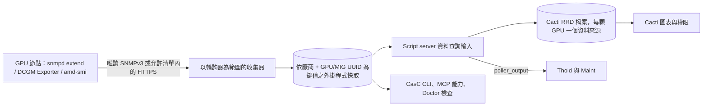

<!-- Source: README.md; SHA256: 97ba37df4a883426d3984ed7d14547ad7367e973411a8abd930409ce259f545b -->

<!-- translations:start -->
[English](../../../README.md) | [简体中文](../zh-CN/README.md) | [हिन्दी](../hi-IN/README.md) | [Español (España)](../es-ES/README.md) | [Español (Latinoamérica)](../es-419/README.md) | [العربية (السعودية)](../ar-SA/README.md) | [Afrikaans](../af-ZA/README.md) | [አማርኛ](../am-ET/README.md) | [العربية (مصر)](../ar-EG/README.md) | [العربية (المغرب)](../ar-MA/README.md) | [বাংলা](../bn-BD/README.md) | [Bosanski](../bs-BA/README.md) | [Deutsch](../de-DE/README.md) | [فارسی](../fa-IR/README.md) | [Filipino](../fil-PH/README.md) | [Français](../fr-FR/README.md) | [Français (Maroc)](../fr-MA/README.md) | [Français (Sénégal)](../fr-SN/README.md) | [Hausa](../ha-NG/README.md) | [עברית](../he-IL/README.md) | [Hrvatski](../hr-HR/README.md) | [Bahasa Indonesia](../id-ID/README.md) | [Igbo](../ig-NG/README.md) | [Italiano](../it-IT/README.md) | [日本語](../ja-JP/README.md) | [한국어](../ko-KR/README.md) | [Malagasy](../mg-MG/README.md) | [मराठी](../mr-IN/README.md) | [Bahasa Melayu](../ms-MY/README.md) | [Nederlands](../nl-NL/README.md) | [Polski](../pl-PL/README.md) | [Português (Brasil)](../pt-BR/README.md) | [Русский](../ru-RU/README.md) | [Kinyarwanda](../rw-RW/README.md) | [Soomaali](../so-SO/README.md) | [Српски](../sr-RS/README.md) | [Svenska](../sv-SE/README.md) | [Kiswahili](../sw-KE/README.md) | [தமிழ்](../ta-IN/README.md) | [తెలుగు](../te-IN/README.md) | [ไทย](../th-TH/README.md) | [Türkçe](../tr-TR/README.md) | [Українська](../uk-UA/README.md) | [اردو](../ur-PK/README.md) | [Tiếng Việt](../vi-VN/README.md) | [isiXhosa](../xh-ZA/README.md) | [Yorùbá](../yo-NG/README.md) | [繁體中文](README.md) | [isiZulu](../zu-ZA/README.md)
<!-- translations:end -->

# plugin_gpu

一個將 NVIDIA 與 AMD 工具提供的單顆 GPU 使用率、記憶體、溫度、功耗、ECC 錯誤與降頻原因匯入 Cacti 的 Cacti 1.2 外掛程式。每顆 GPU（或 MIG 執行個體）都會成為其節點裝置上資料查詢的一個索引，因此 GPU 圖表會遵循 Cacti 的權限設定與節點的其他圖表並列顯示，且 Thold 與 Maint 也能對其發出告警及抑制告警。

> **狀態：第 1 至第 3 階段已在程式碼中實作，尚未發布。** 第 1 階段（透過 SNMP extend 收集 NVIDIA `nvidia-smi`、識別追蹤、圖表、降頻與 ECC 訊號、Thold 與 Maint 告警、健康狀態頁面）、第 2 階段（唯讀 NVIDIA DCGM Exporter HTTP(S) 剖析器/用戶端與 AMD `amd-smi` 剖析器）、第 3 階段（MIG 執行個體識別追蹤、Schema v4 欄位、以輪詢器為範圍的遠端收集器執行、`replicate_out` 與 `remote_agent` 掛鉤）、CasC 操作人員 CLI（`cli/gpu.php`）以及生態系統掛鉤（`abilities_register`、`doctor_register_checks`、`casc_register_providers`）皆已實作，並涵蓋於單元測試、安全性測試與拋棄式 Cacti 整合測試中。截至目前為止的實際執行僅使用合成 `snmpd` 與測試資料載荷，而非實體 GPU 硬體。標記正式版本前仍待完成的項目：真實硬體試行（[docs/pilot-plan.md](../../pilot-plan.md)、#54）、外部安全性審查（[docs/security-review.md](../../security-review.md)）、從真實工具擷取的測試資料（#14），以及在正式環境規模硬體上的效能實測（[docs/performance.md](../../performance.md)）。XID 錯誤收集依決策 #8 仍維持未定案。

## 存取角色

| 領域 | 存取權限 |
| --- | --- |
| GPU View | 現有的監控頁面。 |
| GPU Operator | 監控頁面，外加「Operations」頁面與個人分診確認。 |
| GPU Admin | Operator 存取權限，外加現有的設定與管理操作。 |

複製升級檔案後，請以管理員身分開啟「Plugins」頁面以註冊新的領域。請在 **Configuration > Users** 或使用者群組中明確指派 Operator 領域。升級會保留現有的 View 與 Admin 領域 ID 及授權。每次請求時，Admin 權限會繼承 Operator 權限，而 Operator 權限會繼承 View 權限；這不會在使用者或群組上新增儲存的授權記錄。外掛程式設定除了需要 Cacti 的 Settings 權限外，還需要 GPU Admin 存取權限。

Cacti 裝置權限仍會限制每位使用者可檢視的資料列與操作；未對應的物件需要管理員權限。憑證、設定、對應、刪除及其他管理變更仍保留在管理頁面中。確認狀態僅在目前使用者的工作階段中有效，最長維持一小時，且僅在該筆觀測資料仍維持在有效時限內時有效。新的或有所變動的觀測資料會使其失效。確認狀態永遠不會將失敗的量測標記為正常，也不會抑制告警。

## 開發緣由

GPU 節點通常已納入 Cacti 中監控 CPU、記憶體與網路介面。然而 GPU 健康狀態是節點 SNMP 資料無法回答的另一個問題：即使節點本身看似運作正常，加速卡仍可能因過熱而降頻、累積 ECC 錯誤或回報 XID 故障。廠商工具（`nvidia-smi`、DCGM、`amd-smi`）雖能回報這些資訊，但其輸出並不屬於 Cacti 的圖表、權限控管與告警體系。

本外掛程式透過將廠商工具的輸出轉換為 Cacti 資料來源來填補這項缺口，並以每顆 GPU 的識別資訊而非插槽位置作為索引鍵，因此重新開機導致 GPU 順序改變時，不會將一張卡的歷史紀錄接到另一張卡上。它直接沿用 Cacti 的繪圖、權限、遠端資料收集器、Thold 與 Maint，而非另行打造平行系統。

## 規劃範圍

| 階段 | 範圍 | 狀態 | 里程碑 |
|---|---|---|---|
| 0，研究 | 廠商工具輸出、XID 與降頻訊號、GPU 識別、權限、收集路徑決策 | 已完成 | [M1](https://github.com/somethingwithproof/plugin_gpu/milestone/1) |
| 1，nvidia | `nvidia-smi` 資料收集、依 UUID 建立清冊、圖表、降頻與 ECC 訊號、Thold 與 Maint、健康狀態頁面 | 已實作（已通過測試資料測試） | [M2](https://github.com/somethingwithproof/plugin_gpu/milestone/2), [M3](https://github.com/somethingwithproof/plugin_gpu/milestone/3), [M4](https://github.com/somethingwithproof/plugin_gpu/milestone/4) |
| 2，後端 | 唯讀 DCGM Exporter HTTP(S) 剖析器/用戶端（`lib/DcgmExporterParser.php`、`lib/DcgmExporterClient.php`）、AMD `amd-smi` 剖析器（`lib/AmdSmiParser.php`） | 已實作（已通過單元測試） | [M5](https://github.com/somethingwithproof/plugin_gpu/milestone/5) |
| 3，MIG、遠端與生態系統 | MIG 執行個體識別追蹤、遠端資料收集器（`INFO`、`poller_gpu.php --poller=N`、`replicate_out`、`remote_agent`）、CasC CLI（`cli/gpu.php`）、MCP/Doctor/CasC 掛鉤 | 已實作（已通過單元與 CI 整合測試） | [M6](https://github.com/somethingwithproof/plugin_gpu/milestone/6) |

不涵蓋的範圍：任何會變更 GPU 或節點狀態的指令（時脈、功耗上限、重設、MIG 配置）、外掛程式專屬的告警引擎、自訂背景服務程式或網路協定，以及排程器或工作帳務紀錄。待研究項目清單請參閱規劃文件。

## 里程碑 4 新增項目

- **NVIDIA DCGM Exporter 唯讀收集器**（`lib/DcgmExporterParser.php`、`lib/DcgmExporterClient.php`）。剖析 Prometheus 文字格式指標（`DCGM_FI_DEV_GPU_UTIL`、`DCGM_FI_DEV_FB_USED`、`DCGM_FI_DEV_FB_FREE`、`DCGM_FI_DEV_POWER_USAGE`、`DCGM_FI_DEV_GPU_TEMP`、`DCGM_FI_DEV_ECC_DBE_VOL_TOTAL`、`DCGM_FI_DEV_CLOCK_THROTTLE_REASONS`，以及 MIG 標籤 `GPU_I_ID` 與 `GPU_I_PROFILE`）。HTTP(S) 用戶端強制執行明確的端點主機/CIDR 允許清單、預設驗證 TLS 對等憑證、限制逾時與回應大小、停用重新導向，並拒絕非 HTTP(S) 協定配置。
- **AMD `amd-smi` 唯讀剖析器**（`lib/AmdSmiParser.php`）。將 `amd-smi` JSON/SNMP-extend 輸出（使用率、VRAM、功耗、接面/邊緣溫度、ECC、分割區中繼資料，以及透過 `Reading::$vendorExtensions` 記錄的獨立降頻累計器）正規化至 `Vendor::Amd` 下的通用指標模型。
- **MIG 執行個體追蹤與 Schema v4**（`lib/GpuReport.php`、`lib/GpuSnapshot.php`、`lib/GpuRecord.php`、`lib/Schema.php`、`lib/ScriptServer.php`）。與父層 GPU 一併追蹤 MIG 執行個體 UUID（`MIG-<uuid>` 與 `MIG-GPU-<parent>/<gi>/<ci>`）、`mig_mode`、`mig_instance_id`、`mig_profile`、`parent_uuid` 與 `partition_info`，同時在更新時保護不可變的識別鍵值（`vendor`、`uuid`、`parent_uuid`），並於資料庫查詢前進行驗證。
- **遠端資料收集器**（`INFO`、`poller_gpu.php`、`lib/Poller.php`、`lib/ReplicationRepository.php`、`setup.php`）。於 `INFO` 宣告 `remote_collect:1, remote_poller:1`，支援透過 `php plugins/gpu/poller_gpu.php --poller=N` 進行以輪詢器為範圍的執行，在非主要輪詢器上略過 Cacti 物件佈建，透過 `replicate_out` 複寫以輪詢器為範圍的資料表，並透過 `remote_agent` 回應唯讀的 `gpu_health` 與 `gpu_inventory` 動作。
- **操作人員與 CasC CLI**（`cli/gpu.php`、`lib/CascProvider.php`）。無須外部 Composer 相依套件即可執行於 PHP 8.2+（可於 PHP 8.0 通過語法剖析）：`php plugins/gpu/cli/gpu.php export [--format=yaml|xml]`、`validate <file> [--format=yaml|xml]`、`plan <file> [--format=yaml|xml] [--output=text|json]`、`apply <file> --confirm=<PLAN_HASH> [--format=yaml|xml]` 與 `health [--format=text|json]`。計畫會計算具決定性的 SHA-256 確認雜湊值，`apply` 在雜湊不符時會以失敗終止，且 XML 剖析會拒絕 `DOCTYPE` 與 `ENTITY` 宣告。
- **生態系統整合掛鉤**（`lib/EcosystemIntegration.php`、`setup.php`）。註冊 `abilities_register`（`gpu-list-nodes`、`gpu-list-devices`、`gpu-get-health`；唯讀，受 `GPU View` 領域與 Cacti 裝置權限控管）、`doctor_register_checks`（`gpu_schema`、`gpu_poller_freshness`、`gpu_node_health`）與 `casc_register_providers`。
- **將降頻原因與 ECC 作為告警數值**（[docs/metrics.md](../../metrics.md)）。將時脈事件遮罩解碼為 0/1 指標，並將每個區間新增的可修正/不可修正 ECC 錯誤計算為 gauge 數值，使 Thold 1.8.2 與 Maint 1.3 能發出告警與抑制告警，而不致出現負值計數器或重設尖峰（[docs/alerting.md](../../alerting.md)）。
- **GPU Health、權限控管、故障/還原與規模測試。** GPU Health（GPU View）無須連線至節點即可顯示已儲存的新鮮度、上次收集結果、Maint 狀態、後端、版本與原始降頻遮罩。腳本化的端對端測試驗證了權限控管、代理程式/資料庫/RRD 故障復原（[docs/backup.md](../../backup.md)），以及 CI 中的 100 顆 GPU 規模測試（[docs/performance.md](../../performance.md)、[docs/operations.md](../../operations.md)、[CHANGELOG.md](../../../CHANGELOG.md)）。

## 里程碑 3 新增項目

- **透過 SNMP extend 收集資料**（[ADR 0008](../../decisions/0008-collect-through-snmp-extend.md)）。節點管理員只需在 `snmpd.conf` 中加入兩行固定的 `extend` 設定（[docs/node-setup.md](../../node-setup.md)）；外掛程式會透過 Cacti 的 SNMP 函式並使用該裝置自身的憑證（建議使用 SNMPv3）讀取 NET-SNMP-EXTEND-MIB。外掛程式不會在 Cacti 伺服器或節點上執行任何程式。
- **嚴格剖析。** 欄位依位置讀取，每一行都會以 UUID 標明所屬的 GPU；非零結束狀態碼、逾時、輸出截斷、欄位數量錯誤的行，或混雜的錯誤訊息文字，都會導致整次收集失敗：數值會變為 `U`，不會有任何 GPU 被標記為缺席，且 GPU Nodes 頁面會顯示失敗原因。
- **在每個輪詢器週期後執行的收集器。** 它會讀取每個已啟用節點的代理程式、更新識別紀錄並快取最新取樣。script server 輸入僅讀取該快取，因此 Cacti 輪詢絕不會等待 GPU 節點回應。
- **Cacti 物件**（[ADR 0010](../../decisions/0010-attach-to-existing-node-devices.md)）。範本與 *GPU - Devices* 資料查詢以 XML 格式隨附，並於安裝及升級時匯入。儲存節點時會將該資料查詢附加至其現有裝置（重新索引方法設為 None）；僅當節點沒有對應裝置時，GPU Nodes 才能建立新裝置。每顆 GPU 皆為以廠商與 UUID 為索引鍵的項目，共用同一個資料來源，用於繪製 Utilization、Memory、Temperature、Power、Power Percent、Clocks、Throttle、ECC Errors、New ECC Errors、Retired Pages 與 Sample Age 圖表。每個模型欄位都會由某張圖表繪製，因為 Cacti 僅儲存圖表有使用的欄位。外掛程式會在每次 GPU 異動後重新索引，保留因裝置處於 Down 或停用狀態而被 Cacti 略過的重新索引操作並於裝置恢復 Up 時執行，且會為新加入的 GPU 建立圖表。
- **歷史紀錄隨卡保留。** 缺席的 GPU 仍會保留為索引，因此其圖表會顯示斷層，待其恢復時則繼續寫入同一個 RRD 檔案。安裝於相同插槽的更換卡會取得屬於自己的資料來源。節點頁面上的 **Remove from Data Query** 可將缺席的 GPU 從清單中移除；除非您手動刪除，否則其 RRD 檔案與圖表都會保留。
- **GPU Nodes 的裝置權限控管。** GPU Admin 僅能檢視、變更、匯出與移動在 Cacti 中有權檢視之裝置上的節點與 GPU；移動 GPU 需要同時擁有兩個節點的權限。若節點所對應的裝置已被刪除，該節點可被停用或刪除。
- **通用指標模型**（[ADR 0009](../../decisions/0009-common-metric-core-with-vendor-extensions.md)、[docs/metrics.md](../../metrics.md)）。記憶體單位為位元組，時脈事件遮罩會解碼為 `thr_*` 指標，而 `age` 則為該 GPU 自身取樣時間至今的經過時間，若未知則為 `U`。

執行安裝的使用者（網頁伺服器執行身分）必須能寫入 `<cacti>/resource/script_server/`，外掛程式會將其資料查詢 XML 放置於該處；否則安裝與升級會停止並顯示提示訊息，並在下次嘗試時重試。只有當勾選 *Remove the plugin's Cacti objects on uninstall* 時，解除安裝才會移除範本與 XML，且絕不會刪除 RRD 檔案、裝置、圖表或資料來源（[docs/operations.md](../../operations.md#uninstall)）。位於遠端資料收集器上的節點會依其指派的 `poller_id` 範圍執行。

## 里程碑 2 交付項目

- **受保護的安裝機制。** 在低於 PHP 8.2 的環境中，安裝與啟用會被拒絕並顯示指明所需版本的訊息，而 Cacti 的其餘部分仍可正常運作。`setup.php` 與各頁面指令碼皆可在 PHP 8.0 上通過語法剖析。
- **生命週期管理。** 透過 Cacti 的 Plugins 頁面進行安裝、升級、停用與解除安裝。升級過程具順序性，中斷後可接續完成，且僅在成功後才會更新記錄的版本號。除非取消勾選 *Keep Plugin Tables on Uninstall*，否則解除安裝會保留外掛程式的資料表；它絕不會更動任何 Cacti 裝置、資料來源、圖表或 RRD 檔案。
- **獨立權限領域。** *GPU Admin* 可開啟 **GPU Nodes**，用於將 Cacti 裝置註冊為 GPU 節點、確認或拒絕 GPU 在節點間的移動，以及將所有紀錄匯出為 JSON。*GPU View* 可開啟 **GPU Inventory**，僅列出檢視者有權查看之裝置上的 GPU。這兩個頁面皆位於 Management 選單下，且所有變更皆為經 csrf-magic 驗證的 POST 請求。
- **GPU 識別紀錄。** 每顆 GPU 皆以廠商與 UUID 作為唯一鍵值。索引、PCI 匯流排 ID、名稱、驅動程式與回報工具為可原地更新的屬性。在已知插槽出現新的 UUID 時會標記為可能的更換卡，並啟用新的歷史紀錄；在另一個節點偵測到的 GPU 僅在操作人員確認後才會移動；在多次成功收集中失蹤的 GPU 會在達到可設定的次數後標記為缺席，且永不刪除。目前僅接受 NVIDIA 整張 GPU 的 UUID；MIG 執行個體需等待決策 #13，AMD 則需等待研究 #19。由於尚未有收集器饋送資料，這些規則目前由測試資料序列進行驗證。
- **測試與 CI。** 包含無須 GPU 或資料庫的單元與原始碼規則測試套件、針對 PHP 8.2 至 8.5 上 Cacti 1.2.31 及現行 1.2.x 的生命週期與頁面權限檢查、PHP 8.1 拒絕執行測試工作、進入點檔案的 PHP 8.0 語法檢查、PHPStan level 9 靜態分析以及 REUSE 合規檢查。在 #12 定案前，此測試架構仍為暫定版本。

### 安裝供評估測試

以下步驟用於安裝目前的程式碼以供試用；完整的操作人員指南請參閱 [docs/operations.md](../../operations.md)。此環境需使用執行於 PHP 8.2 或更新版本的 Cacti 1.2.31 或更新版本。

1. 將此儲存庫複製到 Cacti 目錄下的 `plugins/gpu`。目錄名稱必須為 `gpu`。
2. 在 Cacti 中開啟 **Configuration > Plugins**，接著安裝並啟用 **GPU**。
3. 依據使用者角色，在 **Configuration > Users** 下為使用者指派 *GPU View*、*GPU Operator* 或 *GPU Admin* 領域。執行安裝的使用者會自動取得 View 與 Admin 權限；Admin 包含 Operator 存取權限。
4. 依照 [docs/node-setup.md](../../node-setup.md) 的說明設定每個 GPU 節點的 SNMP 代理程式，然後在 **Management > GPU Nodes** 下新增該節點。
5. 若需告警功能，請依照 [docs/alerting.md](../../alerting.md) 的說明匯入隨附的 Thold 範本。
6. 視需要調整 **Configuration > Settings > GPU** 中的選項：*Mark Absent After*（預設為 3 次成功收集，範圍 1 至 100）、*Stale After*（取樣資料在經過多久後其數值會輸出 `U`）以及 *Keep Plugin Tables on Uninstall*（預設啟用）。

## 指標如何進入 Cacti

決策 [#7](https://github.com/somethingwithproof/plugin_gpu/issues/7) 選擇了 SNMP `extend`（[ADR 0008](../../decisions/0008-collect-through-snmp-extend.md)）：由節點自身的代理程式執行固定的 `nvidia-smi` 指令，外掛程式僅讀取結果。規劃文件於 [Collection paths](../../PLAN.md#collection-paths) 一節中比較了各種選項。

## 相容性目標

| 元件 | 目標 |
|---|---|
| Cacti | 1.2.31 或更新版本，無須修改核心程式碼 |
| PHP | 8.2 或更新版本；`setup.php` 保持與 8.0 語法相容，使不支援的執行環境能顯示拒絕訊息而非導致 Cacti UI 毀損 |
| NVIDIA | 驅動程式與工具版本線將由研究 [#26](https://github.com/somethingwithproof/plugin_gpu/issues/26) 定案；DCGM 欄位 ID 已於 v3.3.9 與 v4.7.0 驗證 |
| AMD | ROCm 版本上的 `amd-smi` 將由研究 [#26](https://github.com/somethingwithproof/plugin_gpu/issues/26) 定案 |
| Thold, Maint | 未經修改的 Thold 1.8.2 與 Maint 1.3，已完成端對端測試（[docs/alerting.md](../../alerting.md)） |

## 架構設計

- [docs/PLAN.md](../../PLAN.md) 為完整規劃文件：涵蓋架構、其所依賴的上游事實（附來源）、識別模型、安全邊界、效能估算、測試與風險。
- [docs/decisions/](../../decisions) 存放已做出的架構決策紀錄。
- [docs/REQUIREMENTS.md](../../REQUIREMENTS.md) 將每個需求 ID 對應至其議題。

## 工作追蹤方式

- **里程碑**對應規劃中的各個里程碑。每個里程碑皆有一則史詩議題，列出其子議題與結案證據。
- **議題**依標籤分類：`type: requirement`、`type: research`、`type: decision`、`type: epic`。需求議題會載明編號、可測試的需求（`REQ-AREA-NNN`）與驗收標準。
- **標籤**亦包含 `area:`、`phase:`、`priority:` 與 `status:`。詳見 [CONTRIBUTING.md](../../../CONTRIBUTING.md#labels)。
- [專案看板](https://github.com/users/somethingwithproof/projects/9)顯示跨里程碑的所有議題。

## 參與貢獻

請閱讀 [CONTRIBUTING.md](../../../CONTRIBUTING.md)。提交紀錄必須包含 DCO 簽署。設計討論均於議題中進行；尚未定案的決策會帶有 `type: decision` 標籤。從真實 GPU 工具擷取的輸出是對里程碑 1 最有幫助的貢獻；提交前請先移除主機名稱、序號與 UUID。

## 安全性

請私下回報弱點；詳情請參閱 [SECURITY.md](../../../SECURITY.md)。

## 授權條款

GNU General Public License v2.0，與 Cacti 及其外掛程式採用相同的授權條款。詳見 [LICENSE](../../../LICENSE)。
