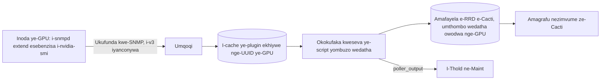

<!-- Source: README.md; SHA256: 97ba37df4a883426d3984ed7d14547ad7367e973411a8abd930409ce259f545b -->

<!-- translations:start -->
[English](../../../README.md) | [简体中文](../zh-CN/README.md) | [हिन्दी](../hi-IN/README.md) | [Español (España)](../es-ES/README.md) | [Español (Latinoamérica)](../es-419/README.md) | [العربية (السعودية)](../ar-SA/README.md) | [Afrikaans](../af-ZA/README.md) | [አማርኛ](../am-ET/README.md) | [العربية (مصر)](../ar-EG/README.md) | [العربية (المغرب)](../ar-MA/README.md) | [বাংলা](../bn-BD/README.md) | [Bosanski](../bs-BA/README.md) | [Deutsch](../de-DE/README.md) | [فارسی](../fa-IR/README.md) | [Filipino](../fil-PH/README.md) | [Français](../fr-FR/README.md) | [Français (Maroc)](../fr-MA/README.md) | [Français (Sénégal)](../fr-SN/README.md) | [Hausa](../ha-NG/README.md) | [עברית](../he-IL/README.md) | [Hrvatski](../hr-HR/README.md) | [Bahasa Indonesia](../id-ID/README.md) | [Igbo](../ig-NG/README.md) | [Italiano](../it-IT/README.md) | [日本語](../ja-JP/README.md) | [한국어](../ko-KR/README.md) | [Malagasy](../mg-MG/README.md) | [मराठी](../mr-IN/README.md) | [Bahasa Melayu](../ms-MY/README.md) | [Nederlands](../nl-NL/README.md) | [Polski](../pl-PL/README.md) | [Português (Brasil)](../pt-BR/README.md) | [Русский](../ru-RU/README.md) | [Kinyarwanda](../rw-RW/README.md) | [Soomaali](../so-SO/README.md) | [Српски](../sr-RS/README.md) | [Svenska](../sv-SE/README.md) | [Kiswahili](../sw-KE/README.md) | [தமிழ்](../ta-IN/README.md) | [తెలుగు](../te-IN/README.md) | [ไทย](../th-TH/README.md) | [Türkçe](../tr-TR/README.md) | [Українська](../uk-UA/README.md) | [اردو](../ur-PK/README.md) | [Tiếng Việt](../vi-VN/README.md) | [isiXhosa](../xh-ZA/README.md) | [Yorùbá](../yo-NG/README.md) | [繁體中文](../zh-TW/README.md) | [isiZulu](README.md)
<!-- translations:end -->

# plugin_gpu

I-plugin ye-Cacti 1.2 eletha ukusetshenziswa kwe-GPU ngayinye, inkumbulo, izinga lokushisa, amandla, amaphutha e-ECC, kanye nezizathu zokuncishiswa kwesivinini (throttling) ezivela kumathuluzi e-NVIDIA zingene ku-Cacti. Ukusekelwa kwe-AMD kanye nokuqoqwa kwamaphutha e-XID kuhleliwe, akukasetshenziswa. I-GPU ngayinye iba yinkomba (index) yombuzo wedatha kudivayisi yenoda yayo, ukuze amagrafu e-GPU ahlale eduze kwamanye amagrafu enoda ngaphansi kwezimvume ze-Cacti, futhi i-Thold ne-Maint zikwazi ukukhipha izexwayiso futhi zizicindezele.

> **Isimo: kusekuthuthukisweni, akukakhishwa.** Ingqophamlando yesi-4 yenza isigaba soku-1 (i-NVIDIA ngokusebenzisa i-SNMP extend) siphelele ngekhodi: ukuqoqwa, ubunikazi, amagrafu, amasignali okunciphisa isivinini ne-ECC, izexwayiso ze-Thold ne-Maint, ikhasi lempilo, kanye nemibhalo yomsebenzisi wokuphatha. Isebenze kuphela ngokumelene ne-`snmpd` yangempela nge-`nvidia-smi` mbumbulu ephrinta okukhiphayo okwakhiwe, ayikaze isebenze ku-hardware ye-GPU. Okusavulekile ngaphambi kokukhishwa: izivivinyo zokuqala ku-hardware yangempela ([docs/pilot-plan.md](../../pilot-plan.md), #54), ukubuyekezwa kokuphepha kwangaphandle ([docs/security-review.md](../../security-review.md)), amafixture athathwe kumathuluzi angempela (#14), kanye nesilinganiso esikalwe ku-hardware elingana neyokukhiqiza ([docs/performance.md](../../performance.md)). Amaphutha e-XID alinde isinqumo #8. Ungayisebenzisi endaweni yokukhiqiza (production).

## Izindima zokufinyelela

| Indawo (Realm) | Ukufinyelela |
| --- | --- |
| GPU View | Amakhasi okugada akhona. |
| GPU Operator | Ukugada kanye nekhasi le-Operations kanye nezivumelwano zomuntu siqu zokuhlola izinkinga (triage). |
| GPU Admin | Ukufinyelela kwe-Operator kanye nokucushwa okukhona nezenzo zokuphatha. |

Ngemuva kokukopisha amafayela okuthuthukisa, vula ikhasi le-Plugins njengomlawuli (administrator) ukuze ubhalise indawo (realm) entsha. Yabela indawo ye-Operator ngokucacile ngaphansi kwe-**Configuration > Users** noma amaqembu abasebenzisi. Ukuthuthukiswa kugcina ama-ID endawo ye-View ne-Admin akhona kanye nezimvume ezinikeziwe. Ukufinyelela kwe-Admin kudla ifa lokufinyelela kwe-Operator, futhi ukufinyelela kwe-Operator kudla ifa lokufinyelela kwe-View esicelweni ngasinye; lokhu akwengezi izimvume ezigciniwe kubasebenzisi noma kumaqembu. Izilungiselelo ze-plugin zidinga futhi ukufinyelela kwe-GPU Admin ngaphezu kwemvume ye-Settings ye-Cacti.

Izimvume zedivayisi ye-Cacti zisalinganisela imigqa nezenzo ezitholakala kumsebenzisi ngamunye; izinto ezingabalaziwe zidinga umlawuli. Izifakazelo, ukucushwa, ukubalazela, ukususa nezinye iziguquko zokuphatha zihlala emakhasini okuphatha. Izivumelwano zihlala kuphela kuseshini yomsebenzisi yamanje, isikhathi esingeqile ehoreni elilodwa futhi kuphela uma okubonwe okufanayo kusakusha. Okubonwe okusha noma okushintshile kuyaziqeda amandla. Azikaze ziphawule isilinganiso esehlulekile njengesiphilile noma zicindezele izexwayiso.

## Kungani

Amanoda e-GPU ngokuvamile avele ekhona ku-Cacti nge-CPU, inkumbulo, kanye nezixhumi (interfaces). Impilo ye-GPU iwumbuzo ohlukile idatha ye-SNMP yenoda engawuphenduli: ikhadi lingancishiswa isivinini ngenxa yokushisa, liqongelele amaphutha e-ECC, noma libike iphutha le-XID ngenkathi inoda ngokwayo ibukeka iphilile. Amathuluzi abakhiqizi ayakubika lokhu (`nvidia-smi`, i-DCGM, `amd-smi`), kodwa okukhiphayo kwawo kuhlala ngaphandle kwamagrafu, izimvume, kanye nezexwayiso ze-Cacti.

I-plugin ivula leli thuba ngokuguqula okukhiphayo kwethuluzi lomkhiqizi kube yimithombo yedatha ye-Cacti, ekhiywe ngobunikazi be-GPU ngayinye kunendawo yayo, ukuze ukuqalisa kabusha okuhlela kabusha ama-GPU kungahlanganisi umlando wekhadi elilodwa nelinye. Isebenzisa kabusha ukudweba amagrafu kwe-Cacti, izimvume, abaqoqi bedatha bakude, i-Thold, kanye ne-Maint kunokwakha izinhlelo zazo ezihambisanayo.

## Ububanzi obuhleliwe

| Isigaba | Ububanzi | Izingqophamlando |
|---|---|---|
| 0, ucwaningo | Okukhiphayo kwethuluzi lomkhiqizi, amasignali e-XID nokunciphisa isivinini, ubunikazi be-GPU, amalungelo, isinqumo sendlela yokuqoqa | [M1](https://github.com/somethingwithproof/plugin_gpu/milestone/1) |
| 1, nvidia | Ukuqoqwa kwe-`nvidia-smi`, uhlu nge-UUID, amagrafu, ukunciphisa isivinini, amasignali e-ECC ne-XID, i-Thold ne-Maint, ikhasi lempilo | [M2](https://github.com/somethingwithproof/plugin_gpu/milestone/2), [M3](https://github.com/somethingwithproof/plugin_gpu/milestone/3), [M4](https://github.com/somethingwithproof/plugin_gpu/milestone/4) |
| 2, ama-backend | I-backend ye-DCGM, i-backend ye-`amd-smi` | [M5](https://github.com/somethingwithproof/plugin_gpu/milestone/5) |
| 3, i-mig nokukude | Izimo ze-MIG, abaqoqi bedatha bakude be-Cacti | [M6](https://github.com/somethingwithproof/plugin_gpu/milestone/6) |

Okungaphandle kobubanzi: noma yimuphi umyalo oshintsha i-GPU noma inoda (amawashi, imikhawulo yamandla, ukusetha kabusha, ukwakheka kwe-MIG), injini yezexwayiso ephethwe yi-plugin, i-daemon yangokwezifiso noma iphrothokholi yenethiwekhi, kanye nokubalwa kwesheduli noma kwemisebenzi. Bheka uhlelo ngomsebenzi wocwaningo osele.

## Okwengezwa yingqophamlando yesi-4

- **Izizathu zokunciphisa isivinini njengamanani ezexwayiso.** I-mask yesenzakalo sewashi ihunyushwa ibe yinkomba eyodwa engu-0 noma u-1 ngesizathu ngasinye; i-mask engaziwa inikeza izinkomba ezingaziwa, hhayi o-zero, futhi ama-bit angenayo inkomba ahlala ku-mask eluhlaza, ekhonjiswa yi-GPU Health.
- **I-ECC njengamanani ezexwayiso** ([docs/metrics.md](../../metrics.md)). Amaphutha amasha alungisiwe nangalungisiwe kusukela kusampula yangaphambilini abalwa yi-plugin kusuka emananini amabili alandelanayo futhi agcinwa njengama-gauge: angaziwa kusampula yokuqala, ukufunda okulahlekile, noma ukulayishwa kabusha komshayeli (driver), ukuze ukusetha kabusha kungafundwa njengo-zero noma njengesibalo esingesihle. Izibalo zamakhasi ahoxisiwe e-single-bit ne-double-bit kanye nemodi ye-ECC kuyafundwa futhi. Amagrafu amabili angeziwe e-ECC nge-GPU ngayinye avumela i-Cacti ukuthi iwabeke; kanye ne-Power Percent, kunamagrafu ayishumi nanye esewonke. I-XID ayiqoqwa: awukho umthombo ofanelana nemiyalo ehleliwe ye-`nvidia-smi` (#8).
- **I-Thold ne-Maint** ([docs/alerting.md](../../alerting.md)). Izifanekiso ze-Thold ezithunyelwayo zezinga lokushisa, amandla ngokumelene nomkhawulo wawo, izinkomba zokunciphisa isivinini, amaphutha amasha e-ECC angalungisiwe, ukuhoxiswa kwekhasi okulindile, kanye nobudala besampula. Lonke inani liyi-gauge, ngoba i-Thold 1.8.2 iyehluleka ku-counter engaziwa. Ukuhlolwa kokuphela nokuphela nge-Thold 1.8.2 ne-Maint 1.3 engashintshiwe kukhombisa umkhawulo ngamunye uqhuma futhi ubuyiselwa, ekusetheni kabusha kwe-ECC, futhi i-Maint ikucindezela.
- **I-GPU Health** (GPU View). Ngenoda ngayinye: ubusha, indlela ukuqoqwa kokugcina okuphele ngayo, isimo se-Maint, i-backend, izinguqulo zethuluzi nezomshayeli, kanye nezibalo ze-GPU; nge-GPU ngayinye: ukuba khona, ubudala besampula, isimo se-ECC, kanye ne-mask eluhlaza. Ifunda amarekhodi agciniwe kuphela.
- **Izimvume.** Uchungechunge lokuhlola izimvume luhlanganisa lonke ifayela lekhasi nesenzo, ukuhoxiswa esicelweni esilandelayo, kanye nokwenqaba okungadaluli lutho.
- **Ukuhluleka kanye nokufaneleka kokubuyisela.** Ukusebenza kokuphela nokuphela okubhalwe nge-script kuphula i-agent, izifakazelo, ithuluzi, okukhiphayo kwalo, ukuxhumana kwedathabheyisi, kanye nokubhalwa kwe-RRD, futhi kubuyisela idathabheyisi kusuka ku-dump, kufaka phakathi eyodwa endala kunamafayela e-RRD; i-GPU entsha ayikaze idle ifa lefayela le-RRD lenye ([docs/backup.md](../../backup.md)).
- **Isilinganiso (Scale)** ([docs/performance.md](../../performance.md)). Ukuhlolwa kwesilinganiso kukala isikhathi sokuqoqa, okokufaka kweseva ye-script, ukwakhiwa kwento ye-Cacti, umjikelezo we-poller, kanye nekhasi lempilo esibalweni se-GPU esinikeziwe; i-CI ikusebenzisa kuma-GPU ayi-100. Izilinganiso zama-GPU ayi-1,000 neziyizi-8,000 azikarekhodwa okwamanje, ngakho-ke asikho isibalo se-GPU esisekelwayo esishiwo.
- **Imibhalo yomsebenzisi wokuphatha** ([docs/operations.md](../../operations.md)): ukufaka, ukuthuthukisa, ukukhipha, amalungelo amancane kakhulu, amanani angatholakali, kanye nokuxazulula izinkinga. Izinguquko zibhalwe ku-[CHANGELOG.md](../../../CHANGELOG.md).

## Okwengezwa yingqophamlando yesi-3

- **Ukuqoqwa nge-SNMP extend** ([ADR 0008](../../decisions/0008-collect-through-snmp-extend.md)). Umlawuli wenoda wengeza imigqa emibili ehleliwe ye-`extend` ku-`snmpd.conf` ([docs/node-setup.md](../../node-setup.md)); i-plugin ifunda i-NET-SNMP-EXTEND-MIB ngemisebenzi ye-SNMP ye-Cacti ngezifakazelo zedivayisi ngokwayo, i-SNMPv3 iyanconywa. Ayisebenzisi lutho kuseva ye-Cacti noma kunoda.
- **Ukuhlaziya okuqinile.** Izinkambu zifundwa ngesikhundla, umugqa ngamunye uqamba i-GPU yawo nge-UUID, futhi isimo sokuphuma esingesiye u-zero, ukuphelelwa yisikhathi, okukhiphayo okunqunyiwe, umugqa onesibalo sezinkambu esingalungile, noma umbhalo wephutha ohlanganisiwe kuhlulekisa konke ukuqoqwa: amanani aba ngu-`U`, akukho GPU ephawulwa njengengekho, futhi i-GPU Nodes ikhombisa ukuthi kungani.
- **Umqoqi ngemuva komjikelezo ngamunye we-poller.** Ufunda i-agent yenoda ngayinye enikwe amandla, ubuyekeza amarekhodi obunikazi, futhi ugcina ku-cache isampula yakamuva. Okokufaka kweseva ye-script kufunda leyo cache kuphela, ukuze i-poll ye-Cacti ingakaze ilinde inoda ye-GPU.
- **Izinto ze-Cacti** ([ADR 0010](../../decisions/0010-attach-to-existing-node-devices.md)). Izifanekiso kanye nombuzo wedatha we-*GPU - Devices* kuthunyelwa njenge-XML futhi kungeniswa ekufakweni nasekuthuthukisweni. Ukulondoloza inoda kunamathisela umbuzo wedatha kudivayisi yayo ekhona ngendlela ye-reindex ethi None; i-GPU Nodes ingakha idivayisi kuphela uma inoda ingenayo. I-GPU ngayinye iyinkomba ekhiywe ngomkhiqizi kanye ne-UUID, enomthombo wedatha owodwa owabiwe ngamagrafu ayo e-Utilization, Memory, Temperature, Power, Power Percent, Clocks, Throttle, ECC Errors, New ECC Errors, Retired Pages, kanye ne-Sample Age. Yonke inkambu yemodeli idwetshwa yigrafu ethile, ngoba i-Cacti igcina kuphela izinkambu ezisetshenziswa yigrafu. I-plugin yenza i-reindex ngemuva kwalo lonke ushintsho lwe-GPU, igcina i-reindex eqashwe yi-Cacti ngenkathi idivayisi i-Down noma ikhutshaziwe futhi iyisebenzise uma idivayisi iba ngu-Up, futhi yakha amagrafu ama-GPU amasha.
- **Umlando uhlala nekhadi.** I-GPU engekho ihlala iyinkomba, ukuze amagrafu ayo akhombise igebe futhi aqhubeke efayeleni elifanayo le-RRD uma ibuya. Ikhadi elisha elithatha indawo efanayo lithola owalo umthombo wedatha. I-**Remove from Data Query** ekhasini lenoda ikhipha i-GPU engekho ohlwini; amafayela ayo e-RRD namagrafu ayagcinwa uze uwasuse.
- **Izimvume zedivayisi ku-GPU Nodes.** I-GPU Admin ibona, ishintsha, ikhipha, futhi isusa amanoda nama-GPU kuphela kumadivayisi engavunyelwe ukuwabona ku-Cacti; ukuhambisa i-GPU kudinga womabili amanoda. Inoda edivayisi yayo isusiwe ingakhutshazwa noma isuswe.
- **Imodeli evamile yemethrikhi** ([ADR 0009](../../decisions/0009-common-metric-core-with-vendor-extensions.md), [docs/metrics.md](../../metrics.md)). Inkumbulo ikuma-byte, i-mask yesenzakalo sewashi ihunyushwa ibe yizinkomba ze-`thr_*`, futhi i-`age` iwubudala besikhathi sesampula se-GPU ngokwayo, noma u-`U` uma bungaziwa.

Umsebenzisi ofakayo (weseva yewebhu) kumele akwazi ukubhala ku-`<cacti>/resource/script_server/`, lapho i-plugin ibeka khona i-XML yombuzo wayo wedatha; ukufaka nokuthuthukisa kuyama ngomlayezo uma kungenjalo futhi kuzame futhi emzamweni olandelayo. Ukukhipha kususa izifanekiso ne-XML kuphela uma i-*Remove the plugin's Cacti objects on uninstall* imakiwe, futhi akukaze kususe amafayela e-RRD, amadivayisi, amagrafu, noma imithombo yedatha ([docs/operations.md](../../operations.md#uninstall)). Amanoda akubaqoqi bedatha bakude awaqoqwa kuze kube sesigabeni sesi-3.

## Okuthunyelwa yingqophamlando yesi-2

- **Ukufakwa okuqashiwe.** Ku-PHP engaphansi kuka-8.2, ukufaka nokunika amandla kuyaliwa ngomlayezo oqamba inguqulo edingekayo, futhi yonke enye i-Cacti iyaqhubeka isebenza. I-`setup.php` kanye nemibhalo yamakhasi kuyahlaziyeka ku-PHP 8.0.
- **Umjikelezo wokuphila.** Ukufaka, ukuthuthukisa, ukukhubaza, nokukhipha ngekhasi le-Plugins le-Cacti. Ukuthuthukiswa kuhleliwe ngokulandelana, kuqeda ngemuva kokuphazamiseka, futhi kushintsha inguqulo erekhodiwe kuphela ngemuva kokuphumelela. Ukukhipha kugcina amatafula e-plugin ngaphandle kokuthi ususe uphawu ku-*Keep Plugin Tables on Uninstall*; akukaze kuthinte idivayisi ye-Cacti, umthombo wedatha, igrafu, noma ifayela le-RRD.
- **Izindawo ezihlukene.** I-*GPU Admin* ivula i-**GPU Nodes**, lapho ubhalisa khona amadivayisi e-Cacti njengamanoda e-GPU, uqinisekisa noma wenqaba ukuhamba kwe-GPU phakathi kwamanoda, futhi ukhipha lonke irekhodi njenge-JSON. I-*GPU View* ivula i-**GPU Inventory**, ebala ama-GPU kuphela kumadivayisi umbuki avunyelwe ukuwabona. Womabili amakhasi angaphansi kwe-Management, futhi lonke ushintsho luyi-POST ehlolwa yi-csrf-magic.
- **Amarekhodi obunikazi be-GPU.** I-GPU ngayinye ikhiywe ngumkhiqizi kanye ne-UUID. Inkomba, i-ID yebhasi ye-PCI, igama, umshayeli, kanye nethuluzi elibikayo yizimpawu ezishintsha endaweni. I-UUID entsha esikhundleni esaziwayo iphawulwa njengengase ithathe indawo futhi iqala owayo umlando; i-GPU ebonwe kwenye inoda ihamba kuphela uma umsebenzisi wokuphatha eqinisekisa; i-GPU engekho ekuqoqweni okuphumelelayo iphawulwa njengengekho ngemuva kwesibalo esilungisekayo futhi ayikaze isuswe. Ama-UUID e-GPU ephelele e-NVIDIA kuphela amukelwayo okwamanje; izimo ze-MIG zilinde isinqumo #13, kanti i-AMD ilinde ucwaningo #19. Imithetho isetshenziswa ngochungechunge lwama-fixture, njengoba kungekho mqoqi ozondlayo okwamanje.
- **Ukuhlolwa kanye ne-CI.** Uchungechunge lweyunithi kanye nolwemithetho yomthombo ngaphandle kwe-GPU noma idathabheyisi, ukuhlolwa komjikelezo wokuphila nezimvume zamakhasi ngokumelene ne-Cacti 1.2.31 ne-1.2.x yamanje ku-PHP 8.2 kuya ku-8.5, umsebenzi wokwenqaba we-PHP 8.1, i-lint ye-PHP 8.0 yamaphuzu okungena, i-PHPStan ezingeni lesi-9, kanye ne-REUSE. I-harness ingeyesikhashana kuze kube yilapho #12 ethathwa isinqumo.

### Faka ukuze uhlole

Lezi zinyathelo zifaka ikhodi yamanje ukuze uyizame; i-[docs/operations.md](../../operations.md) inemihlahlandlela ephelele yomsebenzisi wokuphatha. Zidinga i-Cacti 1.2.31 noma kamuva ku-PHP 8.2 noma kamuva.

1. Kopisha inqolobane (repository) ku-`plugins/gpu` ngaphansi kohla lwemibhalo lwakho lwe-Cacti. Uhla lwemibhalo kumele lubizwe nge-`gpu`.
2. Ku-Cacti, vula i-**Configuration > Plugins**, bese ufaka futhi unike amandla i-**GPU**.
3. Nika abasebenzisi indawo ye-*GPU View*, i-*GPU Operator*, noma i-*GPU Admin* ngaphansi kwe-**Configuration > Users**, ngokwendima yabo. Umsebenzisi ofakayo uthola i-View ne-Admin; i-Admin ihlanganisa nokufinyelela kwe-Operator.
4. Setha i-agent ye-SNMP yenoda ngayinye ye-GPU njengoba kuchaziwe ku-[docs/node-setup.md](../../node-setup.md), bese wengeza inoda ngaphansi kwe-**Management > GPU Nodes**.
5. Ngezexwayiso, ngenisa izifanekiso ze-Thold ezithunyelwayo njengoba i-[docs/alerting.md](../../alerting.md) ichaza.
6. Ngokuzithandela lungisa i-**Configuration > Settings > GPU**: i-*Mark Absent After* (okuzenzakalelayo ukuqoqwa okuphumelelayo oku-3, kusuka ku-1 kuya ku-100), i-*Stale After* (ukuthi isampula ingaba ndala kangakanani ngaphambi kokuthi amanani ayo aphrinte u-`U`), kanye ne-*Keep Plugin Tables on Uninstall* (okuzenzakalelayo kuvuliwe).

## Indlela amamethrikhi afinyelela ngayo ku-Cacti

Isinqumo [#7](https://github.com/somethingwithproof/plugin_gpu/issues/7) sikhethe i-SNMP `extend` ([ADR 0008](../../decisions/0008-collect-through-snmp-extend.md)): i-agent yenoda ngokwayo isebenzisa umyalo ohleliwe we-`nvidia-smi` futhi i-plugin ifunda umphumela kuphela. Uhlelo luqhathanisa izinketho ngaphansi kwe-[Izindlela zokuqoqa](../../PLAN.md#collection-paths).

## Izinjongo zokuhambisana

| Ingxenye | Injongo |
|---|---|
| Cacti | 1.2.31 noma kamuva, akukho zilungiso ezibalulekile |
| PHP | 8.2 noma kamuva; i-`setup.php` ihlala ihlaziyeka ku-8.0 ukuze isikhathi sokusebenza esingasekelwa sithole ukwenqatshwa kunokuthi sibe ne-UI ye-Cacti ephukile |
| NVIDIA | Imigqa yomshayeli neyethuluzi izomiswa ngocwaningo [#26](https://github.com/somethingwithproof/plugin_gpu/issues/26); ama-ID ezinkambu ze-DCGM ahlolwe ku-v3.3.9 naku-v4.7.0 |
| AMD | I-`amd-smi` ekukhishweni kwe-ROCm izomiswa ngocwaningo [#26](https://github.com/somethingwithproof/plugin_gpu/issues/26) |
| Thold, Maint | I-Thold 1.8.2 ne-Maint 1.3, ezingashintshiwe, ezihlolwe ukuphela nokuphela ([docs/alerting.md](../../alerting.md)) |

## Ukwakhiwa

- I-[docs/PLAN.md](../../PLAN.md) iwuhlelo olugcwele: ukwakhiwa kwesistimu, amaqiniso aphezulu encike kuwo (kanye nemithombo), imodeli yobunikazi, imingcele yokuphepha, izibalo zokusebenza, ukuhlolwa, kanye nezingozi.
- I-[docs/decisions/](../../decisions) igcina amarekhodi ezinqumo zokwakhiwa kwezinketho esezenziwe kakade.
- I-[docs/REQUIREMENTS.md](../../REQUIREMENTS.md) ibalazela yonke i-ID yemfuneko endabeni yayo.

## Indlela umsebenzi olandelelwa ngayo

- **Izingqophamlando** zilandela izingqophamlando zohlelo. Ngayinye inendaba enkulu ebala izindaba zayo ezingaphansi nobufakazi bokuphuma.
- **Izindaba** zihlukaniswa ngelebula: `type: requirement`, `type: research`, `type: decision`, `type: epic`. Izindaba zemfuneko zisho izimfuneko ezinenombolo, ezihlolwayo (`REQ-AREA-NNN`) kanye nemibandela yokwamukela.
- **Amalebula** nawo athwala `area:`, `phase:`, `priority:`, kanye ne-`status:`. Bheka i-[CONTRIBUTING.md](../../../CONTRIBUTING.md#labels).
- I-[bhodi yephrojekthi](https://github.com/users/somethingwithproof/projects/9) ikhombisa zonke izindaba kuzo zonke izingqophamlando.

## Ukunikela

Funda i-[CONTRIBUTING.md](../../../CONTRIBUTING.md). Ama-commit adinga ukusayinwa kwe-DCO (DCO sign-off). Ingxoxo yokwakhiwa yenzeka ezindabeni; izinqumo ezivulekile zithwala ilebula elithi `type: decision`. Okukhiphayo okuthathiwe kumathuluzi e-GPU angempela kungumnikelo owusizo kakhulu engqophamlandweni yoku-1; susa kuqala amagama amaseva (hostnames), izinombolo ze-serial, kanye nama-UUID.

## Ukuphepha

Bika ubuthakathaka ngasese; bheka i-[SECURITY.md](../../../SECURITY.md).

## Ilayisense

I-GNU General Public License v2.0, ilayisense efanayo neye-Cacti kanye nama-plugin ayo. Bheka i-[LICENSE](../../../LICENSE).
